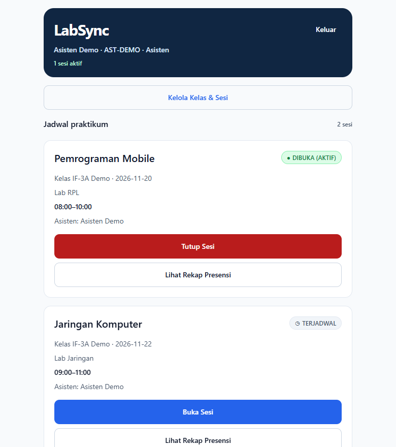

# 🧪 LabSync

Satu app buat praktikum, dari cek jadwal sampai rekap presensi. Asisten buka sesi, praktikan lihat statusnya langsung. Sekarang LabSync lagi masuk Sprint 2, pakai akun Firebase dan data yang bisa diakses bareng.

**Stack** · Expo Router · React Native · TypeScript · Firebase Auth · Cloud Firestore



*Beranda asisten di LabSync web, pakai data demo dari Firebase Emulator.*

## 🚀 Jalanin app

Pakai Node.js 24 LTS (minimal 24.12, sesuai requirement Firebase SDK), lalu run `npm ci` dari root repo.

### Firebase dev bareng tim

1. Ambil config Firebase client dan akun demo dari PM. Buat file `.env.local` dari config itu. Taruh file-nya di folder yang sama dengan `package.json`.
2. Cek project ID-nya `labsync-sprint2-dev` dan `EXPO_PUBLIC_FIREBASE_EMULATORS=false`.
3. Run `npm run web` buat browser, atau `npm start` lalu scan QR dari Expo Go. Kalau HP beda jaringan sama Metro, pakai `npx expo start --tunnel`.

Share hanya baris config `EXPO_PUBLIC_FIREBASE_*` ke tim. Kalau `.env.local` lo juga berisi key Gemini, simpan file itu privat. Password akun demo dikirim terpisah lewat channel privat. Simpan credential Admin dan secret API pengajar di luar Git dan `EXPO_PUBLIC_*`. Kalau perlu akses project, minta invite ke PM. [Firebase Console](https://console.firebase.google.com/project/labsync-sprint2-dev/overview)

### Emulator lokal

Pakai ini kalau mau ngulik rules atau reset data demo sendiri. Firestore Emulator butuh Java 21+.

1. Copy [`.env.example`](.env.example) ke `.env.local`. Biarkan `EXPO_PUBLIC_FIREBASE_EMULATORS=true`.
2. Di terminal pertama, run `npm run firebase:emulators` dan biarkan jalan.
3. Di terminal kedua, run `npm run firebase:seed`, lalu `npm run web`.

| Role | Email emulator | Password emulator |
| --- | --- | --- |
| Asisten | `assistant@labsync.example` | `labsync-local` |
| Praktikan | `student@labsync.example` | `labsync-local` |

**Coba bareng dua akun.** Buka **Pemrograman Mobile** sebagai asisten, lalu presensi sebagai praktikan di profil browser lain. Cek rekap asisten tanpa refresh. Untuk alur izin, kirim alasan dari akun praktikan, buka review dari rekap asisten, lalu lihat keputusan di **Status Izin Saya**. Buat ngulang dari awal, restart emulator tanpa import data, lalu seed ulang. Seed di emulator yang masih jalan mempertahankan status sesi.

<details>
<summary>Pakai emulator dari HP</summary>

Sambungkan HP dan komputer ke Wi-Fi yang sama. Set `host` Auth dan Firestore di `firebase.json` ke IP LAN komputer. Pakai IP itu juga buat `EXPO_PUBLIC_FIREBASE_EMULATOR_HOST`, lalu restart emulator dan Expo. Saat seed, isi `FIREBASE_AUTH_EMULATOR_HOST` dengan `IP_LAN:9099` dan `FIRESTORE_EMULATOR_HOST` dengan `IP_LAN:8080`.

</details>

## 👥 User stories

Sprint 2 sudah bisa dipakai buat daftar akun praktikan, kelola kelas dan sesi, presensi, serta kirim dan review izin. Gemini bantu ngasih kategori alasan izin. Keputusan tetap di tangan asisten.

- **Sebagai praktikan**, gue mau lihat jadwal kelas sendiri dan absen sekali saat sesi dibuka, biar kehadiran gue kecatat dan bisa dicek lagi di riwayat.
- **Sebagai asisten**, gue mau ngatur kelas, peserta, dan jadwal, lalu buka sesi dan lihat siapa yang sudah hadir tanpa refresh.
- **Sebagai praktikan yang berhalangan**, gue mau kirim alasan izin dan bisa cek statusnya dari akun gue.
- **Sebagai asisten yang review izin**, gue mau lihat alasan dan kategori dari AI sebelum gue sendiri putuskan izinnya diterima atau ditolak.

## 🗂️ Dari Sprint 1 ke Sprint 2

| Sprint | Yang dikerjain |
| --- | --- |
| **Sprint 1 · UI & alur lokal** | FR‑01–04 mencakup jadwal, simulasi role, dan kontrol sesi. FR‑05–07 mencakup form presensi, cek duplikat, dan feedback. FR‑08–10 mencakup rekap, riwayat, dan empty state. Semuanya jalan pakai state lokal. |
| **Sprint 2 · Akun & data bareng** | Firebase Auth pegang identitas, Firestore simpan data dan kirim update real-time. Scope-nya nambah pengelolaan data kelas, presensi per akun, serta pengajuan dan review izin. |

Di Sprint 1, **Yudha** pegang beranda, navigasi, dan kontrol sesi. **Agil** pegang kartu praktikan, form, dan feedback presensi. **Zufar** pegang empty state, rekap, dan history. Layar dan komponen yang masih kepakai jadi dasar Sprint 2. [SRS Sprint 1](docs/srs.md) · [Pembagian Sprint 1](docs/programmer.md)

### Siapa pegang apa di Sprint 2?

| SRS | Owner | Scope |
| --- | --- | --- |
| SRS-01 | Daniel | Registrasi, login, role, dan akses akun |
| SRS-02 | Daniel | Firestore dan CRUD kelas, peserta, jadwal, serta sesi |
| SRS-03 | Agiel | Presensi per akun dan pencegahan presensi ganda |
| SRS-04 | Agiel | Pengajuan izin dan integrasi AI buat klasifikasi alasan |
| SRS-05 | Zufar | Rekap dan riwayat presensi real-time |
| SRS-06 | Zufar | Review izin dan keputusan asisten |
| SRS-07 | Bareng tim · Yudha (PM) | Integrasi, testing, dan demo dua akun |

Pendaftaran mandiri buat praktikan. Untuk akun asisten, PM memverifikasi akun dulu lalu menetapkan `role: ASISTEN` di dokumen `users/{uid}` lewat Firebase Console. Server Expo yang manggil Gemini dan simpan hasil klasifikasi. [Kontrak API dan skema Firestore](docs/sprint-2-contract.md)

Asisten membuka **Review izin sesi ini** dari rekap sesi. Praktikan membuka **Status Izin Saya** dari beranda. Hasil AI adalah saran; keputusan asisten tetap dapat dicatat saat AI belum tersedia. [Handoff SRS-05](docs/srs05-handoff.md) · [Handoff dan pengujian SRS-06](docs/srs06-handoff.md)

## 🤖 Klasifikasi izin

Isi `INSTRUCTOR_AI_API_KEY` di `.env.local` di root repo, lalu restart Expo. Server pakai `gemini-3.1-flash-lite` secara default. Set `INSTRUCTOR_AI_MODEL` kalau mau ganti model.

Kalau jalanin Firebase Emulator, isi juga dua host server dari [`.env.example`](.env.example). Pakai alasan sintetis saat ngetes karena teks alasan dikirim ke Gemini. Kalau key kosong, emulator pakai kategori berlabel `Demo:`.

Untuk Firebase dev, server perlu Firebase Admin Application Default Credentials untuk project yang sama. Aplikasi native yang dirilis juga perlu URL server Expo di konfigurasi Expo Router. [Expo API routes](https://docs.expo.dev/router/web/api-routes/)

## 🛠️ Checks

```sh
npm run lint
npx tsc --noEmit
npm run test:rules
```

`test:rules` nyalain emulator sendiri. Stop Firestore yang lagi pakai port `8080` sebelum jalanin command itu.

Buat browser smoke test, mulai dari emulator yang baru di-seed dan Expo web yang lagi jalan. Set `LABSYNC_WEB_URL` kalau Expo pakai port selain `8081`.

```sh
npx playwright install chromium
npm run test:web
```

<details>
<summary>Seed Firebase dev buat PM</summary>

Pakai Application Default Credentials, lalu run `node scripts/seed-firebase.cjs labsync-sprint2-dev`. Simpan password akun baru secara privat. Seed ulang mempertahankan password dan status sesi yang sudah ada.

</details>
