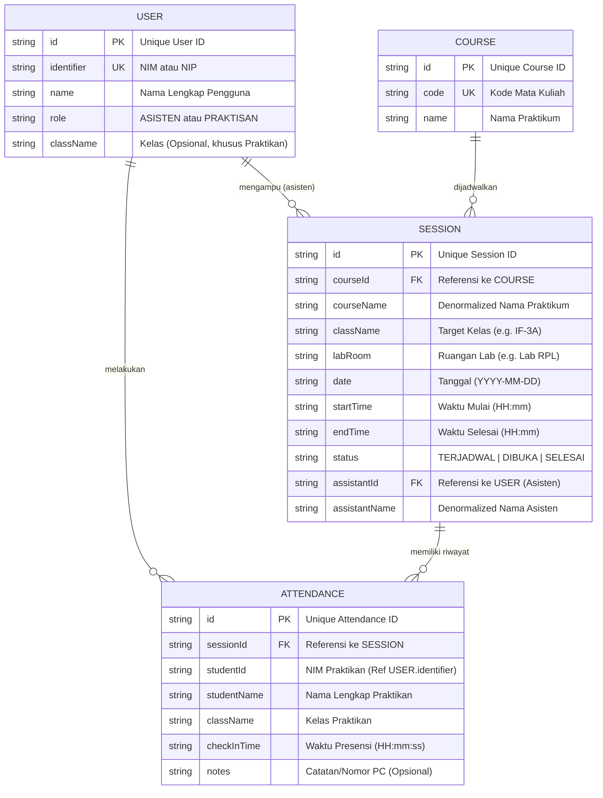

# Entity Relationship Document (ERD) & Data Modeling
## Proyek: LabSync - Sistem Manajemen Praktikum Laboratorium
### Sprint 1: Pemodelan Data & Kontrak In-Memory State

---

## 1. Pendahuluan & Strategi Arsitektur Data

### 1.1 Posisi Data pada Sprint 1
Pada **Sprint 1**, aplikasi LabSync mengadopsi arsitektur **Frontend-Only with In-Memory State**. Tidak ada database relasional eksternal (seperti PostgreSQL/MySQL) maupun backend server yang dihubungkan.

Namun demikian, perancangan struktur data pada dokumen ini disusun mengikuti kaidah **relasional standar industri (3NF / Third Normal Form)**. Tujuannya adalah memastikan bahwa saat transisi ke **Sprint 2 (Database & Cloud Integration)**, tim pengembang tidak perlu merombak struktur entitas dan antarmuka kode (*zero architectural rework*).

---

## 2. Diagram Hubungan Entitas (Entity-Relationship Diagram)

Berikut adalah diagram konseptual dan logis entitas LabSync:



---

## 3. Kamus Data (Data Dictionary)

### 3.1 Entitas: `USER`
Menyimpan identitas pengguna sistem, baik Asisten Laboratorium maupun Praktikan.

| Atribut | Tipe Data | Keterangan Batasan (*Constraint*) | Deskripsi |
| :--- | :--- | :--- | :--- |
| `id` | `VARCHAR(36)` | **PK**, Not Null | Identifier unik pengguna (UUID v4 / ID dummy). |
| `identifier` | `VARCHAR(20)` | **Unique**, Not Null | Nomor Induk Mahasiswa (NIM) untuk praktikan, atau NIP/Kode Asisten. |
| `name` | `VARCHAR(100)` | Not Null | Nama lengkap mahasiswa atau asisten. |
| `role` | `VARCHAR(10)` | Not Null, Enum: `['ASISTEN', 'PRAKTISAN']` | Peran pengguna dalam sistem. |
| `className` | `VARCHAR(20)` | Nullable | Kelas mahasiswa (contoh: `'IF-3A'`). Khusus diisi jika `role = 'PRAKTISAN'`. |

### 3.2 Entitas: `SESSION`
Menyimpan informasi sesi praktikum yang dijadwalkan dan dikelola di laboratorium.

| Atribut | Tipe Data | Keterangan Batasan (*Constraint*) | Deskripsi |
| :--- | :--- | :--- | :--- |
| `id` | `VARCHAR(36)` | **PK**, Not Null | Identifier unik sesi praktikum. |
| `courseName` | `VARCHAR(100)` | Not Null | Nama mata praktikum (contoh: *Pemrograman Mobile*). |
| `className` | `VARCHAR(20)` | Not Null | Kode kelas mahasiswa (contoh: *IF-3A*). |
| `labRoom` | `VARCHAR(50)` | Not Null | Ruangan laboratorium tempat praktikum berlangsung. |
| `date` | `DATE` | Not Null, Format: `YYYY-MM-DD` | Tanggal pelaksanaan sesi praktikum. |
| `startTime` | `VARCHAR(5)` | Not Null, Format: `HH:mm` | Jam mulai praktikum. |
| `endTime` | `VARCHAR(5)` | Not Null, Format: `HH:mm` | Jam perkiraan selesai praktikum. |
| `status` | `VARCHAR(15)` | Not Null, Enum: `['TERJADWAL', 'DIBUKA', 'SELESAI']` | Status siklus hidup operasional sesi praktikum. |
| `assistantName` | `VARCHAR(100)` | Not Null | Nama asisten laboratorium penanggung jawab sesi. |

### 3.3 Entitas: `ATTENDANCE`
Menyimpan catatan presensi kehadiran praktikan pada sesi praktikum tertentu.

| Atribut | Tipe Data | Keterangan Batasan (*Constraint*) | Deskripsi |
| :--- | :--- | :--- | :--- |
| `id` | `VARCHAR(36)` | **PK**, Not Null | Identifier unik catatan presensi. |
| `sessionId` | `VARCHAR(36)` | **FK** -> `SESSION(id)`, Not Null | Relasi ke sesi praktikum yang dihadiri. |
| `studentId` | `VARCHAR(20)` | Not Null | NIM praktikan yang melakukan presensi. |
| `studentName` | `VARCHAR(100)` | Not Null | Nama lengkap praktikan. |
| `className` | `VARCHAR(20)` | Not Null | Kelas praktikan. |
| `checkInTime` | `VARCHAR(8)` | Not Null, Format: `HH:mm:ss` | Waktu stempel presensi berhasil dicatat. |
| `notes` | `VARCHAR(50)` | Nullable | Catatan teknis (contoh: nomor workstation/meja `PC-12`). |

> **Business Constraint Anti-Duplicate (Kunci Unik Komposit)**:
> Kombinasi `sessionId` + `studentId` **harus unik**. Satu praktikan tidak boleh memiliki lebih dari satu baris `ATTENDANCE` pada `sessionId` yang sama.

---

## 4. Kontrak TypeScript (TypeScript Data Contracts)

Kontrak ini ditempatkan pada folder `src/types/` agar seluruh modul antarmuka mengacu pada definisi tipe yang identik (*Single Source of Truth*).

### 4.1 `src/types/user.ts`
```typescript
export type UserRole = 'ASISTEN' | 'PRAKTISAN';

export interface UserProfile {
  id: string;
  name: string;
  identifier: string; // NIM atau NIP/Kode Asisten
  role: UserRole;
  className?: string; // Khusus praktikan, misal: 'IF-3A'
}
```

### 4.2 `src/types/session.ts`
```typescript
export type SessionStatus = 'TERJADWAL' | 'DIBUKA' | 'SELESAI';

export interface Session {
  id: string;
  courseName: string;   // Contoh: 'Pemrograman Mobile'
  className: string;    // Contoh: 'IF-3A'
  labRoom: string;      // Contoh: 'Lab Multimedia 2'
  startTime: string;    // Format: '08:00'
  endTime: string;      // Format: '10:00'
  date: string;         // Format: '2026-10-22'
  status: SessionStatus;
  assistantName: string;
}
```

### 4.3 `src/types/attendance.ts`
```typescript
export interface AttendanceRecord {
  id: string;
  sessionId: string;
  studentId: string;    // NIM praktikan
  studentName: string;
  className: string;
  checkInTime: string;  // Contoh: '08:15:22'
  notes?: string;       // Catatan opsional (e.g. 'PC-14')
}

export interface AttendancePayload {
  sessionId: string;
  studentId: string;
  studentName: string;
  className: string;
  notes?: string;
}
```

---

## 5. Dataset Dummy Awal (`src/constants/dummy-data.ts`)

Dataset ini disediakan untuk inisialisasi state aplikasi saat pertama kali diluncurkan pada demo Sprint 1:

```typescript
import { Session } from '../types/session';
import { UserProfile } from '../types/user';
import { AttendanceRecord } from '../types/attendance';

export const DUMMY_USERS: UserProfile[] = [
  {
    id: 'u-asisten-1',
    name: 'Yudha Pratama',
    identifier: 'AST-001',
    role: 'ASISTEN',
  },
  {
    id: 'u-mhs-1',
    name: 'Agil Saputra',
    identifier: '123210001',
    role: 'PRAKTISAN',
    className: 'IF-3A',
  },
  {
    id: 'u-mhs-2',
    name: 'Zufar Ramadhan',
    identifier: '123210002',
    role: 'PRAKTISAN',
    className: 'IF-3A',
  },
];

export const INITIAL_SESSIONS: Session[] = [
  {
    id: 'ses-001',
    courseName: 'Pemrograman Mobile',
    className: 'IF-3A',
    labRoom: 'Lab Rekayasa Perangkat Lunak',
    startTime: '08:00',
    endTime: '10:00',
    date: '2026-10-22',
    status: 'TERJADWAL',
    assistantName: 'Yudha Pratama',
  },
  {
    id: 'ses-002',
    courseName: 'Basis Data Lanjut',
    className: 'SI-3B',
    labRoom: 'Lab Basis Data Terdistribusi',
    startTime: '10:30',
    endTime: '12:30',
    date: '2026-10-22',
    status: 'DIBUKA',
    assistantName: 'Yudha Pratama',
  },
  {
    id: 'ses-003',
    courseName: 'Jaringan Komputer',
    className: 'IF-3C',
    labRoom: 'Lab Jaringan & Keamanan',
    startTime: '13:30',
    endTime: '15:30',
    date: '2026-10-22',
    status: 'SELESAI',
    assistantName: 'Yudha Pratama',
  },
];

export const INITIAL_ATTENDANCES: AttendanceRecord[] = [
  {
    id: 'att-001',
    sessionId: 'ses-002',
    studentId: '123210001',
    studentName: 'Agil Saputra',
    className: 'SI-3B',
    checkInTime: '10:35:14',
    notes: 'PC-09',
  },
];
```

---

## 6. Validasi State & Aturan Integritas Data

1. **State Transmutation Rules**:
   - `TERJADWAL` -> `DIBUKA` (Diizinkan, trigger oleh Asisten).
   - `DIBUKA` -> `SELESAI` (Diizinkan, trigger oleh Asisten).
   - `SELESAI` -> `DIBUKA` (**Dilarang**, status selesai bersifat terminal pada Sprint 1).
2. **Attendance Anti-Duplicate Logic**:
   ```typescript
   const isAlreadyCheckedIn = attendances.some(
     (att) => att.sessionId === targetSessionId && att.studentId === activeUser.identifier
   );
   ```
3. **Data Isolation per Session**:
   - Query rekapitulasi asisten memfilter data kehadiran berdasarkan `sessionId`:
   ```typescript
   const sessionAttendances = attendances.filter(att => att.sessionId === currentSessionId);
   ```
