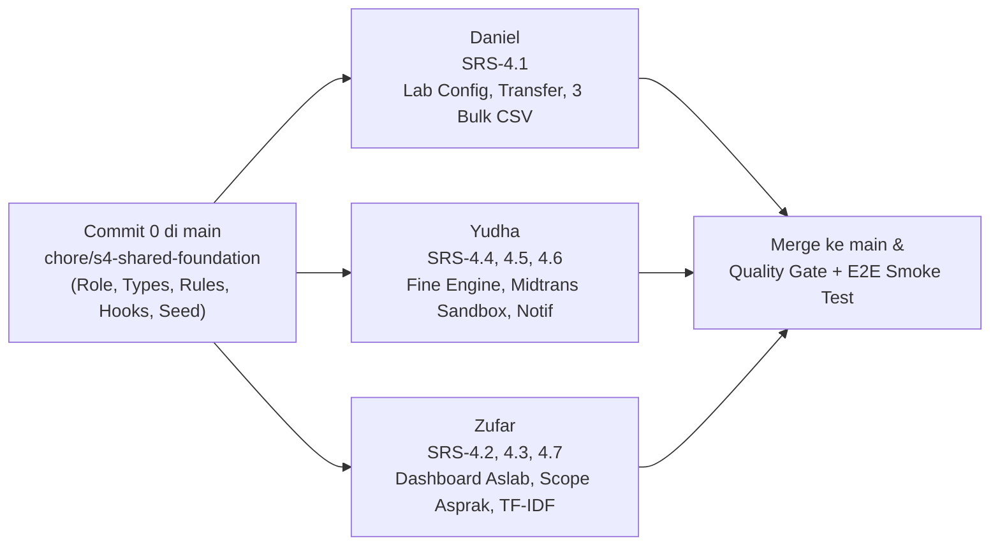

# SRS Rangkuman Sprint 4 — LabSync

> **Single Source of Truth Kebutuhan:** [`docs/last_sprint/resource/kebutuhan_sprint_4.md`](../resource/kebutuhan_sprint_4.md) dan [`docs/last_sprint/resource/notes.md`](../resource/notes.md) *(bersifat read-only / tidak dimodifikasi)*.  
> **Dokumen ini** adalah hub teknis rangkuman untuk realisasi Sprint 4 oleh 3 programmer (**Daniel**, **Yudha**, **Zufar**) secara paralel setelah 1 *Pre-Branch Foundation Commit* di `main`.

---

## 1. Audit Diff 3 Kolom (Codebase Saat Ini vs `kebutuhan_sprint_4.md`)

Hasil audit langsung terhadap codebase saat ini (`src/app/`, `src/data/`, `src/lib/`, `src/server/`, `firestore.rules`, `package.json`):

| 1. Sudah Ada di Codebase (Sesuai Sprint 4) | 2. Ada di Codebase, Belum/Tidak Ada di `kebutuhan_sprint_4.md` | 3. Ada di `kebutuhan_sprint_4.md`, Belum Ada di Codebase (Gap Sprint 4) |
| :--- | :--- | :--- |
| • Manajemen Lab dasar: daftar, detail, edit nama, gedung/lantai, koordinat GPS, radius validasi (`src/app/(app)/lab/`).<br>• Manajemen Kelas & Sesi dasar: buat/edit sesi, buka/tutup sesi, batas keterlambatan `lateAfterMin` (*grace period*) di `Session` & `evaluateCheckIn()` (`src/lib/attendance-rules.ts`).<br>• Presensi praktikan validasi GPS radius + anti-mock + anti-duplikat & rekap presensi sesi (`src/app/(app)/presensi/`, `rekap/`).<br>• Pengajuan izin praktikan & review approve/reject (`src/app/(app)/izin/`).<br>• Sistem notifikasi real-time berbasis Firestore (`src/app/(app)/notifikasi.tsx`, koleksi `notifications`).<br>• Arsitektur backend `POST /api/act` berbasis Expo Server + Firebase Admin SDK + transaksi Firestore (`src/server/act.ts`, `vercel.json`).<br>• Dependency pendukung sudah terpasang di `package.json`: `expo-web-browser`, `react-native-webview`, `expo-file-system`, `expo-sharing`, `write-excel-file`. | • Fitur **Kuis** interaktif & anti-cheat (`src/app/(app)/kuis/`, `src/data/quiz.ts`).<br>• Fitur **Penilaian / Grade Book** (`Assignment`, `Grades`, `src/components/app/grade-book.tsx`).<br>• **Presensi QR berotasi** setiap 15 detik (`src/app/(app)/qr/`, `src/app/(app)/scan.tsx`, `sessionSecrets`).<br>• **Audit Log hash-chain** (`src/app/(app)/(tabs)/log.tsx`, `src/data/audit.ts`).<br>• **Peta interaktif & foto ruangan lab** (`src/app/(app)/(tabs)/peta.tsx`, `labPhotos`).<br>• Klasifikasi **kategori** alasan izin (Sakit, Keluarga, Akademik, dll.) via Gemini/keyword di `src/server/classify-leave.ts`.<br>• Nomenklatur role lama masih `'PRAKTIKAN' \| 'ASISTEN' \| 'SUPERADMIN'` (di `types.ts`, `firestore.rules`, dan 34 file lainnya). | • **Role `ASLAB` & Pembatasan Ketat `ASPRAK`**: migrasi role ke `'ASLAB' \| 'ASPRAK' \| 'PRAKTIKAN'`; seluruh manajemen lab/kelas/distribusi dipindah ke `ASLAB`; `ASPRAK` **hanya** buka sesi, tutup sesi, pantau presensi, dan kelola izin.<br>• **3 Fitur Bulk Insert Terpisah** (Lab per 1 mata kuliah, Praktikan ke lab/kelas, Asprak ke lab/kelas) + **Downloadable Template CSV** + **ScrollView Preview interaktif** (*accept*/*deny*, edit/isi field kosong sebelum simpan).<br>• **Pemindahan Praktikan** dari satu laboratorium/kelas ke laboratorium/kelas lainnya.<br>• **Dashboard Keberlangsungan Laboratorium (Aslab)** dengan filter **hari / minggu / bulan**, statistik lab & praktikan, status sesi per lab, jadwal berjalan/mendatang, riwayat kegiatan lab, dan **riwayat keuangan denda praktikum**.<br>• **Sistem Denda Keterlambatan**: nominal tetap per kejadian `TERLAMBAT`, tepat 1 tagihan per kejadian, relasi ke `nim` + `sessionId` + `attendanceId`, bebas denda untuk izin disetujui (*excused absence*), bayar denda tidak mengubah status hadir.<br>• **Integrasi Payment Gateway Midtrans Sandbox**: alur `client -> server -> Midtrans`, verifikasi webhook/signature di backend, status `pending` / `success` / `failed`, & **Riwayat Pembayaran** persisten.<br>• **Notifikasi Pembayaran**: tagihan denda baru dibuat, pembayaran berhasil, pembayaran gagal/butuh penyelesaian.<br>• **Analisis Sentimen Model Lokal (TF-IDF)** untuk alasan izin (`positif`, `negatif`, `netral`) tersimpan di Firestore bersama dokumen izin + fallback aman saat error. |

---

## 2. Traceability Matrix (Hub ke File Granular)

| Kode SRS | Modul / Ringkasan Kebutuhan | Programmer | Dokumen Detail | Branch Utama (`feat/`, `fix/`, `chore/`) | Dependensi |
| :--- | :--- | :--- | :--- | :--- | :--- |
| **Commit 0** | Shared Foundation: migrasi role `ASLAB`/`ASPRAK`/`PRAKTIKAN`, kontrak data `Fine`/`PaymentTransaction`/`LeaveSentiment`, seed, rules, & stub hooks | Lead / PM | Section 5 dokumen ini | `chore/s4-shared-foundation` *(merge ke `main` duluan)* | Tidak ada (Prasyarat Paralel) |
| **SRS-4.1** | Manajemen Laboratorium oleh Aslab, Pindah Praktikan, & 3 Bulk Insert CSV + ScrollView Review | **Daniel** | [`daniel.md`](./daniel.md) | `feat/s4-lab-config-aslab`<br>`feat/s4-bulk-insert-csv`<br>`feat/s4-transfer-praktikan` | Commit 0 saja *(Paralel)* |
| **SRS-4.2** | Dashboard Keberlangsungan Laboratorium Aslab (Filter Hari/Minggu/Bulan + Riwayat Keuangan) | **Zufar** | [`zufar.md`](./zufar.md) | `feat/s4-aslab-dashboard` | Commit 0 saja *(Paralel)* |
| **SRS-4.3** | Pengelolaan Sesi oleh Asprak & Pembatasan Kewenangan Ketat | **Zufar** | [`zufar.md`](./zufar.md) | `fix/s4-asprak-role-scope` | Commit 0 saja *(Paralel)* |
| **SRS-4.4** | Perhitungan Keterlambatan (*Grace Period*) & Pengelolaan Denda Tetap | **Yudha** | [`yudha.md`](./yudha.md) | `feat/s4-fine-engine` | Commit 0 saja *(Paralel)* |
| **SRS-4.5** | Integrasi Payment Gateway Midtrans Sandbox (`client -> server -> Midtrans` + Webhook) | **Yudha** | [`yudha.md`](./yudha.md) | `feat/s4-midtrans-sandbox` | Commit 0 saja *(Paralel)* |
| **SRS-4.6** | Notifikasi Pembayaran & Halaman Riwayat Pembayaran Persisten | **Yudha** | [`yudha.md`](./yudha.md) | `feat/s4-payment-notif-history` | Commit 0 saja *(Paralel)* |
| **SRS-4.7** | Integrasi AI Analisis Sentimen Lokal (TF-IDF) & Pengelolaan Izin (*Excused Absence*) | **Zufar** | [`zufar.md`](./zufar.md) | `feat/s4-tfidf-sentiment-leave` | Commit 0 saja *(Paralel)* |

### Diagram Alur Eksekusi Paralel



---

## 3. Matriks Hak Akses Role (`ASLAB`, `ASPRAK`, `PRAKTIKAN`)

> **Aturan Baku (dari `notes.md`):** Seluruh fitur manajemen lab/kelas/distribusi dipindahkan ke **`ASLAB`**. **`ASPRAK`** hanya memiliki kewenangan operasional sesi (buka sesi, tutup sesi, pantau/kelola presensi, dan kelola izin). Segala fitur manajemen tambahan di masa depan wajib masuk ke **`ASLAB`**, bukan `ASPRAK`.

| Kewenangan / Fitur | `ASLAB` | `ASPRAK` | `PRAKTIKAN` |
| :--- | :---: | :---: | :---: |
| CRUD Laboratorium (nama, lokasi, koordinat, radius, grace period, nominal denda) | **Ya** | Tidak | Baca info ruang |
| Bulk / Single Insert terpisah (Lab per matkul, Praktikan ke lab, Asprak ke lab) | **Ya** | Tidak | Tidak |
| Memindahkan praktikan antar lab / mengatur penugasan asprak & aslab | **Ya** | Tidak | Tidak |
| Dashboard Keberlangsungan Lab (filter hari/minggu/bulan + riwayat kegiatan & keuangan denda) | **Ya** | Tidak | Tidak |
| Melihat daftar kelas, jadwal, & sesi yang menjadi tanggung jawabnya | Semua kelas | **Kelas sendiri** | Kelas terdaftar |
| Membuka & menutup sesi praktikum (sinkron real-time) | Ya *(override)* | **Ya (kelas sendiri)** | Tidak |
| Memantau & mengelola presensi praktikan sesi | Ya | **Ya (kelas sendiri)** | Presensi diri sendiri |
| Meninjau pengajuan izin + melihat hasil analisis sentimen AI (accept/reject) | Ya | **Ya (kelas sendiri)** | Ajukan & pantau status |
| Mengajukan izin, melihat tagihan denda, membayar via Midtrans Sandbox, melihat riwayat pembayaran | Pantau rekap keuangan | Tidak | **Ya (diri sendiri)** |

---

## 4. Spesifikasi Ringkas Kebutuhan Fungsional (`SRS-4.1` – `SRS-4.7`)

### `SRS-4.1` — Manajemen Laboratorium oleh Aslab *(Owner: Daniel)*
- Menambah dan mengelola data laboratorium: nama, kode, gedung/lantai, koordinat (`lat`, `lng`), cakupan radius validasi presensi (`radiusM`), batasan keterlambatan default (`defaultLateAfterMin`), dan nominal denda default (`defaultFineAmount`).
- Menyediakan **3 fitur Bulk / Single Insert yang dipisah** (tidak digabung menjadi satu form):
  1. Bulk/Single Insert **Laboratorium** berdasarkan satu mata kuliah.
  2. Bulk/Single Insert **Praktikan** ke laboratorium/kelas tertentu.
  3. Bulk/Single Insert **Asprak** ke laboratorium/kelas tertentu.
- Menyediakan tombol **Download Template `.csv`** untuk masing-masing fitur bulk insert *(detail skema kolom 3 file CSV ditentukan oleh Daniel saat implementasi `SRS-4.1`)*.
- Setiap baris (*row*) hasil unggahan CSV dirender ke dalam daftar interaktif berbasis **`ScrollView`** sehingga Aslab dapat memilih **Accept / Deny** per baris serta **mengedit atau melengkapi field yang kosong** sebelum menyimpan ke Firestore.
- Memindahkan praktikan dari satu laboratorium/kelas ke laboratorium/kelas lainnya (dan mengelola penugasan asprak/aslab; tidak perlu perpindahan jadwal praktikum).

### `SRS-4.2` — Dashboard Keberlangsungan Laboratorium *(Owner: Zufar)*
- Dashboard khusus role `ASLAB` yang membaca data real-time dari **Cloud Firestore** (`labs`, `classes`, `sessions`, `users`, `fines`, `payments`).
- Menampilkan minimal:
  1. Jumlah laboratorium dan jumlah praktikan.
  2. Status kegiatan praktikum pada setiap laboratorium (sedang digunakan / terjadwal / kosong).
  3. Informasi lokasi dan waktu pelaksanaan.
  4. Jadwal praktikum yang sedang berlangsung maupun yang akan datang.
  5. Riwayat kegiatan laboratorium.
  6. Riwayat keuangan hasil dari denda praktikum (total lunas, tertunda, belum dibayar, dan daftar transaksi).
- Menyediakan filter periode berdasarkan **Hari**, **Minggu**, dan **Bulan**.

### `SRS-4.3` — Pengelolaan Sesi oleh Asprak *(Owner: Zufar)*
- Asprak melihat daftar kelas, jadwal, dan sesi praktikum yang menjadi tanggung jawabnya (`assistantNims`).
- Membuka sesi saat praktikum dimulai dan menutup sesi setelah praktikum selesai dengan sinkronisasi **real-time** (Firestore `onSnapshot`) ke aplikasi praktikan.
- Memantau dan mengelola presensi praktikan pada sesi tanggung jawabnya.
- Menjamin isolasi kewenangan: menyembunyikan dan memblokir (baik UI maupun API `src/server/act.ts`) akses Asprak ke pembuatan/edit lab, bulk insert, perpindahan praktikan, dan manajemen kelas/pengguna.

### `SRS-4.4` — Perhitungan Keterlambatan & Pengelolaan Denda *(Owner: Yudha)*
- Mekanisme ***grace period***:
  - Presensi saat `serverNow <= session.startsAt + session.lateAfterMin * 60_000` → **`HADIR`** (tepat waktu, tanpa denda).
  - Presensi saat `serverNow > session.startsAt + session.lateAfterMin * 60_000` → **`TERLAMBAT`** (memicu pembuatan denda).
- Durasi toleransi (`lateAfterMin`) dan nominal denda tetap (`fineAmount`) dapat dikonfigurasi per kebijakan lab/sesi.
- Setiap kejadian keterlambatan menghasilkan **tepat satu tagihan denda** (menggunakan ID deterministik `${sessionId}__${nim}` sehingga idempotent).
- Tagihan terhubung ke identitas praktikan (`nim`), sesi (`sessionId`), kelas (`classId`), dan catatan presensi (`attendanceId`).
- Pembayaran denda **tidak mengubah** status kehadiran praktikan (`TERLAMBAT` tetap tercatat `TERLAMBAT`).
- **Kebijakan Izin**: Praktikan yang izinnya disetujui oleh Asprak dicatat sebagai `IZIN` (*excused absence*), tidak berubah menjadi `HADIR`, dan **dibebaskan dari denda** (tidak dibuat tagihan; jika ada tagihan terkait, statusnya di-`waived`).

### `SRS-4.5` — Integrasi Payment Gateway Midtrans Sandbox *(Owner: Yudha)*
- Menggunakan **Midtrans Sandbox** (tanpa uang sungguhan) dengan arsitektur aman **`client -> server -> payment gateway`**:
  - `MIDTRANS_SERVER_KEY` hanya boleh ada di environment server (Vercel / Expo Server API routes), **dilarang keras** memakai prefix `EXPO_PUBLIC_*` atau ditaruh di kode client React Native.
- Alur transaksi:
  1. Praktikan melihat daftar tagihan dan rincian nominal denda.
  2. Client memanggil `POST /api/payment/create` dengan Firebase ID Token dan `fineId`.
  3. Server memvalidasi kepemilikan tagihan & nominal dari Firestore, membuat transaksi Midtrans Snap Sandbox, menyimpan dokumen `payments/{orderId}` (`status: 'pending'`), lalu mengembalikan `snapToken` / `redirectUrl`.
  4. Client membuka halaman pembayaran Midtrans Snap (`expo-web-browser` atau `react-native-webview`).
  5. Midtrans mengirim callback ke `POST /api/payment/webhook`. Server memverifikasi `signature_key = SHA512(order_id + status_code + gross_amount + MIDTRANS_SERVER_KEY)` sebelum mengubah status menjadi `pending`, `success`, atau `failed` dan memperbarui dokumen `fines/{fineId}`.
- Status akhir pembayaran **tidak boleh** ditentukan hanya dari redirect/callback client; wajib terverifikasi melalui backend/webhook (atau endpoint verifikasi status server ke Midtrans API).

### `SRS-4.6` — Notifikasi & Riwayat Pembayaran *(Owner: Yudha)*
- Terintegrasi dengan sistem notifikasi yang ada (`notifications` di Firestore & `src/app/(app)/notifikasi.tsx`).
- Praktikan menerima notifikasi untuk 3 kejadian pembayaran:
  1. `FINE_CREATED` — Tagihan denda baru dibuat.
  2. `PAYMENT_SUCCESS` — Pembayaran berhasil diverifikasi.
  3. `PAYMENT_FAILED` — Pembayaran gagal / kedaluwarsa / butuh penyelesaian lebih lanjut.
- Halaman **Riwayat Pembayaran** menampilkan minimal: **sesi praktikum, tanggal tagihan, nominal, waktu transaksi, dan status pembayaran (`pending`/`success`/`failed`)**.
- Data tersimpan di Cloud Firestore (`fines` dan `payments`) sehingga tetap tersedia secara persisten meski aplikasi ditutup dan dibuka kembali.

### `SRS-4.7` — Integrasi AI Analisis Sentimen Lokal (TF-IDF) & Pengelolaan Izin *(Owner: Zufar)*
- Praktikan mengajukan izin pada sesi tertentu dengan menyertakan alasan ketidakhadiran.
- Server menjalankan **model analisis sentimen lokal ringan berbasis TF-IDF** (`src/server/sentiment-tfidf.ts`) untuk mengklasifikasikan kalimat alasan izin menjadi **`positif`**, **`negatif`**, atau **`netral`** (beserta skor kepercayaan).
- Hasil analisis AI disimpan bersama dokumen pengajuan izin di Cloud Firestore (`leaves/{id}.sentiment`).
- Asprak melihat alasan izin beserta hasil analisis sentimen AI untuk praktikan kelas tanggung jawabnya, lalu menerima (`approved`) atau menolak (`rejected`).
- Praktikan memantau status pengajuan izin secara *real-time*.
- **Ketahanan Error (Graceful Fallback):** Jika modul/layanan AI mengalami gangguan atau error, dokumen izin tetap tersimpan dan tetap bisa ditinjau Asprak dengan penanda `sentiment.status = 'unavailable'`.
- **Prinsip Pendukung Keputusan:** Hasil sentimen AI hanya informasi pendukung bagi Asprak, **bukan** pengambil keputusan otomatis.
- Izin yang disetujui terintegrasi ke presensi (`IZIN` / *excused absence*) dan pembebasan denda sesuai `SRS-4.4`.

---

## 5. Spesifikasi Pre-Branch Foundation Commit (`Commit 0`)

> **Tujuan:** Diselesaikan dan di-merge ke `main` **sebelum** Daniel, Yudha, dan Zufar membuat branch, sehingga seluruh kontrak tipe, role, rules, dan hook ekstensi sudah stabil dan ketiganya dapat bekerja **100% paralel tanpa merge conflict**.

- **Branch:** `chore/s4-shared-foundation`
- **Cakupan Perubahan Wajib:**
  1. **Migrasi Role (`'PRAKTIKAN' | 'ASPRAK' | 'ASLAB'`):**
     - Rename tipe `Role` di `src/data/types.ts` (`SUPERADMIN` → `ASLAB`, `ASISTEN` → `ASPRAK`).
     - Update referensi string role di `firestore.rules`, `src/server/act.ts`, `src/server/auth-routes.ts`, `src/data/store.tsx`, `src/data/selectors.ts`, `src/data/nav.ts`, `src/data/demo-seed.ts`, `src/data/actions.ts`, `src/app/login.tsx`, dan seluruh screen/komponen yang merujuk `SUPERADMIN` / `ASISTEN` (total 36 file teridentifikasi saat audit).
     - Di `src/server/act.ts`, kunci `authorize()`: `ASLAB` akses penuh manajemen; `ASPRAK` hanya boleh menjalankan `openSession`, `closeSession`, `overrideAttendance`, `reviewLeave` pada kelas tempat ia terdaftar di `assistantNims` (cabut izin `saveLab`, `createSessions`, `updateSession`, `enroll`, `unenroll`, `setClassLinks`, dll. dari `ASPRAK`).
  2. **Kontrak Data Sprint 4 di `src/data/types.ts`:**
     ```ts
     export type Role = 'PRAKTIKAN' | 'ASPRAK' | 'ASLAB';

     // Tambahan field pada Lab:
     // courseId?: string;
     // defaultLateAfterMin?: number; // default 15
     // defaultFineAmount?: number;   // default 10000 (IDR)

     // Tambahan field pada Session:
     // fineAmount?: number;

     export type FineStatus = 'unpaid' | 'pending' | 'paid' | 'waived';
     export type PaymentStatus = 'pending' | 'success' | 'failed';

     export interface Fine {
       /** Deterministik: `${sessionId}__${nim}` (maksimal 1 tagihan per kejadian terlambat). */
       id: string;
       nim: string;
       sessionId: string;
       classId: string;
       attendanceId: string;
       amount: number;
       status: FineStatus;
       createdAt: number;
       paidAt?: number;
       waivedAt?: number;
       waivedReason?: string;
       latestOrderId?: string;
     }

     export interface PaymentTransaction {
       /** Midtrans order_id unik, misal `LS-${sessionId}-${nim}-${ts}`. */
       id: string;
       fineId: string;
       nim: string;
       sessionId: string;
       classId: string;
       amount: number;
       status: PaymentStatus;
       snapToken?: string;
       redirectUrl?: string;
       paymentType?: string;
       midtransTransactionId?: string;
       midtransStatus?: string;
       createdAt: number;
       updatedAt: number;
       paidAt?: number;
     }

     export type SentimentLabel = 'positif' | 'negatif' | 'netral';

     export interface LeaveSentiment {
       label?: SentimentLabel;
       score?: number;
       status: 'ok' | 'unavailable';
       model: 'local-tfidf';
       analyzedAt: number;
     }

     // Tambahan field pada LeaveRequest:
     // sentiment?: LeaveSentiment;

     // Tambahan pada NotificationType:
     // | 'FINE_CREATED' | 'PAYMENT_SUCCESS' | 'PAYMENT_FAILED'

     // Tambahan pada NavSlot:
     // | 'dashboard' | 'denda'
     ```
  3. **Modular Hook Anti-Konflik (agar 3 programmer tidak mengedit `actions.ts` / `act.ts` bersamaan):**
     - Buat file stub kosong yang sudah di-wire dari `src/data/actions.ts` & `src/server/act.ts`:
       - `src/data/actions-aslab.ts` *(Owner selanjutnya: Daniel)* — ekspor stub `transferStudent`, `bulkInsertLabs`, `bulkInsertStudents`, `bulkInsertAssistants`.
       - `src/data/actions-fine.ts` & `src/lib/fine-rules.ts` *(Owner selanjutnya: Yudha)* — ekspor hook `onAttendanceRecorded(draft, attendance, session, lab, notify)` dan `onLeaveApproved(draft, leave, session)` yang dipanggil otomatis oleh `checkIn` dan `reviewLeave`.
       - `src/server/sentiment-tfidf.ts` *(Owner selanjutnya: Zufar)* — ekspor stub `analyzeLeaveSentiment(reason: string): LeaveSentiment` yang dipanggil di post-transaction hook `submitLeave` di `src/server/act.ts`.
  4. **Store, Seed, Navigasi & Firestore Rules:**
     - Tambahkan koleksi `fines: Fine[]` dan `payments: PaymentTransaction[]` di `DemoState` (`src/data/demo-seed.ts`) beserta minimal 3–5 data dummy realistis agar Dashboard Keuangan (Zufar) dan UI Tagihan (Yudha) bisa langsung jalan independen.
     - Tambahkan subscription `fines` dan `payments` di `src/data/store.tsx` (`ASLAB`: semua; `PRAKTIKAN`: `where('nim', '==', nim)`).
     - Tambahkan aturan read-only di `firestore.rules` untuk `fines/{id}` dan `payments/{id}` (`signedIn() && (isAslab() || resource.data.nim == request.auth.uid)`).
     - Daftarkan route shortcut/tab di `src/data/nav.ts`:
       - `ASLAB`: shortcut ke `/dashboard-lab`, `/lab`, `/lab/transfer`, `/admin`.
       - `PRAKTIKAN`: shortcut/slot ke `/denda` dan `/denda/riwayat`.
       - `ASPRAK`: hanya slot/shortcut operasional (`jadwal`, `presensi`, `izin`, `notifikasi`).
  5. **Verifikasi Commit 0:** `npx tsc --noEmit && npx expo lint` wajib lolos 0 error sebelum merge ke `main`.

---

## 6. Konvensi Branching, Commit & Physical File Ownership

### 6.1 Konvensi Branch & Commit
Hanya gunakan tiga prefix resmi berikut:
- `feat/<scope>-<deskripsi-singkat>` — fitur baru (contoh: `feat/s4-midtrans-sandbox`).
- `fix/<scope>-<deskripsi-singkat>` — perbaikan bug / pembatasan akses / penyesuaian aturan (contoh: `fix/s4-asprak-role-scope`).
- `chore/<scope>-<deskripsi-singkat>` — setup fondasi, refactor, dokumentasi, atau config (contoh: `chore/s4-shared-foundation`).

Aturan kerja Git:
1. Semua programmer membuat branch dari commit `main` terbaru **setelah Commit 0 di-merge**.
2. Gunakan *Conventional Commits* (`feat(...)`, `fix(...)`, `chore(...)`).
3. **No-Overlap Rule:** Dilarang memodifikasi file di luar daftar *File Ownership* masing-masing tanpa koordinasi dengan pemiliknya.
4. Wajib lulus `npx tsc --noEmit` dan `npx expo lint` sebelum membuka Pull Request ke `main`.

### 6.2 Ringkasan Matriks Kepemilikan File (Nol Tumpang Tindih)

| Programmer | File / Folder yang Dimiliki (Exclusive Ownership) |
| :--- | :--- |
| **Daniel** (`SRS-4.1`) | `src/data/actions-aslab.ts`, `src/lib/csv-bulk.ts`, `src/components/aslab/**`, `src/app/(app)/lab/index.tsx`, `src/app/(app)/lab/[id]/index.tsx`, `src/app/(app)/lab/[id]/edit.tsx`, `src/app/(app)/lab/bulk-lab.tsx`, `src/app/(app)/lab/bulk-praktikan.tsx`, `src/app/(app)/lab/bulk-asprak.tsx`, `src/app/(app)/lab/transfer.tsx`, `src/app/(app)/(tabs)/admin.tsx`, `src/app/(app)/kelas/baru.tsx` |
| **Yudha** (`SRS-4.4`, `4.5`, `4.6`) | `src/lib/fine-rules.ts`, `src/data/actions-fine.ts`, `src/server/midtrans.ts`, `src/app/api/payment/create+api.ts`, `src/app/api/payment/webhook+api.ts`, `src/app/api/payment/status+api.ts`, `src/components/payment/**`, `src/app/(app)/denda/index.tsx`, `src/app/(app)/denda/[id].tsx`, `src/app/(app)/denda/riwayat.tsx`, `src/app/(app)/notifikasi.tsx`, `.env.example` |
| **Zufar** (`SRS-4.2`, `4.3`, `4.7`) | `src/server/sentiment-tfidf.ts`, `src/data/selectors-dashboard.ts`, `src/components/dashboard/**`, `src/components/app/status.tsx`, `src/app/(app)/dashboard-lab.tsx`, `src/app/(app)/(tabs)/index.tsx`, `src/app/(app)/(tabs)/izin.tsx`, `src/app/(app)/izin/baru.tsx`, `src/app/(app)/izin/[id].tsx`, `src/app/(app)/(tabs)/kelas.tsx`, `src/app/(app)/kelas/[id].tsx`, `src/app/(app)/sesi/[id]/index.tsx`, `src/app/(app)/rekap/[id].tsx`, `src/app/(app)/(tabs)/presensi.tsx` |

---

## 7. Format Output Form (Siap Salin)

Format baku sesuai `notes.md` (`Nama Programmer - SRS kode : user story`):

```text
Daniel - SRS-4.1 : Sebagai Aslab, saya dapat mengelola konfigurasi laboratorium (lokasi, koordinat, radius, grace period, nominal denda), memindahkan praktikan antar laboratorium, serta melakukan bulk dan single insert secara terpisah (laboratorium per mata kuliah, praktikan ke laboratorium, dan asprak ke laboratorium) menggunakan template CSV yang dapat diunduh dan pratinjau ScrollView interaktif (accept/deny/edit).
Yudha - SRS-4.4 : Sebagai sistem, saya dapat menghitung keterlambatan presensi berdasarkan grace period yang dikonfigurasi dan menghasilkan tepat satu tagihan denda nominal tetap per kejadian keterlambatan tanpa mengubah status kehadiran saat dibayar serta membebaskan denda bagi izin yang disetujui.
Yudha - SRS-4.5 : Sebagai Praktikan, saya dapat melihat tagihan denda dan membayarnya melalui Midtrans Sandbox dengan alur aman client-server-payment gateway yang status pembayarannya diverifikasi melalui webhook backend.
Yudha - SRS-4.6 : Sebagai Praktikan, saya dapat menerima notifikasi ketika tagihan denda baru dibuat, pembayaran berhasil, atau pembayaran gagal, serta melihat halaman riwayat pembayaran yang tersimpan persisten.
Zufar - SRS-4.2 : Sebagai Aslab, saya dapat memantau dashboard keberlangsungan laboratorium berbasis Firebase yang menampilkan jumlah lab dan praktikan, status dan jadwal kegiatan, riwayat kegiatan lab, serta riwayat keuangan denda dengan filter hari, minggu, dan bulan.
Zufar - SRS-4.3 : Sebagai Asprak, saya hanya dapat mengelola sesi praktikum kelas tanggung jawab saya (melihat jadwal, membuka/menutup sesi secara real-time, memantau presensi, dan mengelola izin) tanpa kewenangan konfigurasi lab maupun distribusi praktikan.
Zufar - SRS-4.7 : Sebagai Praktikan dan Asprak, saya dapat mengajukan dan meninjau izin dengan dukungan analisis sentimen model lokal TF-IDF (positif, negatif, netral) yang tersimpan di Cloud Firestore, tetap berjalan aman saat layanan AI terganggu, dan terintegrasi dengan status excused absence serta pembebasan denda.
```
