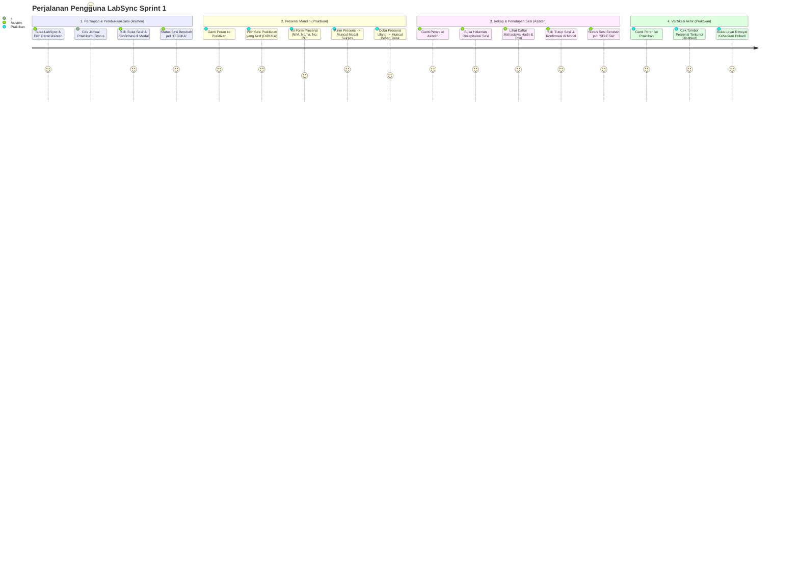

# Product Requirements Document (PRD)
## Proyek: LabSync - Sistem Manajemen Praktikum Laboratorium
### Sprint 1: Antarmuka dan Alur Praktikum (UI & User Interaction Prototype)

---

## 1. Ringkasan Eksekutif & Visi Produk

### 1.1 Visi Produk
**LabSync** adalah aplikasi mobile berbasis React Native (Expo) yang dirancang untuk mendigitalisasi dan menyederhanakan koordinasi operasional praktikum di laboratorium kampus. LabSync menghubungkan dua pemangku kepentingan utama—**Asisten Laboratorium** dan **Praktikan (Mahasiswa)**—dalam satu alur kerja yang terstruktur, mulai dari pengecekan jadwal, pembukaan sesi lab secara resmi, presensi mandiri nirsentuh, hingga pemantauan kehadiran instan.

### 1.2 Sasaran Sprint 1
Sprint 1 berfokus penuh pada **validasi pengalaman pengguna (UX), antarmuka (UI), dan alur interaksi praktikum** tanpa terbebani integrasi basis data atau backend cloud (*frontend-first prototype*). Seluruh data dikelola menggunakan *in-memory state* pada sisi aplikasi mobile, memungkinkan demonstrasi komprehensif alur kerja praktikum end-to-end.

---

## 2. Analisis Masalah & Kebutuhan Pengguna (Problem Statement)

Dalam tata kelola praktikum konvensional di laboratorium komputer/sains, terdapat sejumlah friksi operasional:

| No | Pihak | Masalah di Lapangan | Solusi LabSync Sprint 1 |
| :--- | :--- | :--- | :--- |
| 1 | **Praktikan** | Tidak ada kepastian apakah sesi lab sudah resmi dibuka oleh asisten sebelum masuk ke lab. | Status sesi real-time di UI (`TERJADWAL`, `DIBUKA`, `SELESAI`) dengan warna indikator tegas. |
| 2 | **Praktikan** | Lembar presensi fisik sering mengantre, rawan titip absen, atau lupa terisi. | Form presensi mandiri di ponsel dengan validasi anti-ganda (1 kali per praktikan per sesi). |
| 3 | **Praktikan** | Ragu apakah presensi sudah tercatat dengan sah oleh asisten. | Modal feedback seketika memuat jam presensi tercatat dan riwayat kehadiran pribadi. |
| 4 | **Asisten** | Kesulitan memantau jumlah mahasiswa yang hadir tanpa menghitung manual lembar kertas. | Layar rekapitulasi real-time menampilkan daftar praktikan yang sudah check-in dan total kehadiran. |
| 5 | **Asisten** | Batas akhir praktikum tidak jelas; presensi sering susulan setelah praktikum bubar. | Kontrol buka dan tutup sesi dengan dialog konfirmasi, mengunci form presensi secara otomatis saat sesi selesai. |

---

## 3. Profil Pengguna (User Personas)

### 3.1 Persona 1: Asisten Laboratorium
- **Nama Representatif**: Yudha Pratama (Koordinator Lab Basis Data / Mobile)
- **Karakteristik**: Mahasiswa tingkat akhir / asisten akademik yang mengampu sesi praktikum 2–3 kali seminggu.
- **Tujuan Utama**:
  - Memastikan sesi dimulai tepat waktu dan diumumkan statusnya ke praktikan.
  - Mengetahui secara akurat siapa saja mahasiswa yang hadir di ruangan lab.
  - Mengunci sesi saat praktikum berakhir agar tidak ada presensi liar.
- **Titik Kritis (Pain Points)**:
  - Lelah menginput manual data absensi dari kertas ke spreadsheet.
  - Sering terjadi salah klik jika tombol aksi sesi tidak memiliki konfirmasi.

### 3.2 Persona 2: Praktikan (Mahasiswa)
- **Nama Representatif**: Agil Saputra & Zufar Ramadhan (Mahasiswa Semester 4)
- **Karakteristik**: Mahasiswa peserta praktikum dengan mobilitas tinggi, menggunakan smartphone untuk aktivitas akademik.
- **Tujuan Utama**:
  - Mengecek jadwal praktikum, kode kelas, dan ruangan lab dengan cepat.
  - Melakukan presensi dengan memasukkan nomor PC/catatan saat asisten membuka sesi.
  - Mendapatkan bukti konfirmasi kehadiran instan.
- **Titik Kritis (Pain Points)**:
  - Bingung ketika tombol presensi ditekan berkali-kali tanpa respon jelas.
  - Khawatir presensi tidak tercatat bila tidak ada riwayat check-in.

---

## 4. Alur Perjalanan Pengguna (User Journey)

### 4.1 Skenario Alur Lengkap Sprint 1 (End-to-End Walkthrough)

---

## 5. Rincian Fitur Produk (Feature Breakdown)

### 5.1 Fitur 1: Switcher Peran & Identitas Simulasi (Role & Identity Switcher)
- **Tujuan**: Memfasilitasi demonstrasi multi-peran pada perangkat yang sama tanpa autentikasi login rumit.
- **Komponen**:
  - Toggle segmented button di header: `[ Asisten ]` | `[ Praktikan ]`.
  - Dropdown/pilihan akun praktikan aktif: `Agil Saputra (123210001)` atau `Zufar Ramadhan (123210002)`.
  - Perpindahan peran seketika menyesuaikan hak akses antarmuka (Role-based UI rendering).

### 5.2 Fitur 2: Manajemen Jadwal & Status Sesi
- **Tujuan**: Menyajikan daftar jadwal praktikum terstruktur dan visualisasi status operasional sesi.
- **Informasi Kartu**:
  - Judul mata praktikum (misal: *Pemrograman Mobile*, *Basis Data Lanjut*).
  - Ruangan laboratorium (misal: *Lab Rekayasa Perangkat Lunak*, *Lab Basis Data*).
  - Kelas dan waktu pelaksanaan (misal: *IF-3A | 08:00 - 10:00 WIB*).
  - Badge Status:
    - `TERJADWAL` (Abu-abu netral): Sesi belum dimulai.
    - `DIBUKA` (Hijau emerald): Sesi aktif berlangsung, presensi dapat dilakukan.
    - `SELESAI` (Merah bata): Sesi telah ditutup, presensi dikunci.

### 5.3 Fitur 3: Aksi Kontrol Sesi Asisten
- **Tujuan**: Memberikan kendali penuh pada asisten untuk mengaktifkan dan mengakhiri sesi lab.
- **Interaksi**:
  - Tombol kontekstual: "Buka Sesi" (jika `TERJADWAL`) dan "Tutup Sesi" (jika `DIBUKA`).
  - Dialog modal konfirmasi sebelum status berubah untuk mencegah kesalahan operasional asisten.

### 5.4 Fitur 4: Form Presensi Praktikan & Pencegahan Duplikasi
- **Tujuan**: Mengakomodasi presensi mandiri mahasiswa dengan perlindungan data ganda.
- **Interaksi**:
  - Tombol "Lakukan Presensi" hanya interaktif jika sesi `DIBUKA`.
  - Modal form presensi: Input NIM, Nama, dan Catatan Opsional (misal: Nomor PC `PC-14`).
  - Validasi: Jika NIM telah tercatat pada sesi tersebut, sistem menolak submit dan memunculkan peringatan.
  - Modal feedback sukses: Menampilkan ucapan selamat dan stempel waktu presensi (contoh: `08:15:22 WIB`).

### 5.5 Fitur 5: Rekapitulasi Sesi & Riwayat Kehadiran
- **Tujuan**: Transparansi data kehadiran untuk kedua belah pihak.
- **Sisi Asisten**:
  - Layar rekapitulasi khusus per sesi.
  - Kartu ringkasan total mahasiswa hadir.
  - Daftar nama mahasiswa, NIM, jam presensi, dan nomor PC.
  - Penanganan tampilan kosong (*Empty State*) apabila belum ada mahasiswa yang presensi.
- **Sisi Praktikan**:
  - Layar riwayat kehadiran pribadi yang menampilkan riwayat presensi sesi-sesi yang pernah dihadiri.

---

## 6. Pedoman Desain UI/UX (Design Principles)

1. **Mobile-First & Touch-Friendly**:
   - Area ketuk (*touch target*) tombol minimal 44x44 pt.
   - Penempatan aksi penting di jangkauan ibu jari (*thumb zone*).
2. **Keterbacaan & Hierarki Visual**:
   - Kontras warna mematuhi standar WCAG AA (teks gelap pada background terang).
   - Pemisahan informasi yang jelas menggunakan kartu (*cards*), radius sudut 12pt, dan bayangan lembut (*subtle elevation*).
3. **Pemberian Umpan Balik Instan (Clear Feedback)**:
   - Setiap interaksi kritis (buka sesi, tutup sesi, kirim presensi) disertai modal konfirmasi/sukses.
   - Tombol non-aktif berstatus visual *disabled* (opacity 0.5) dengan teks penjelas alasan dinonaktifkan.
4. **Resilience & Empty States**:
   - Tidak ada layar putih kosong tanpa makna. Seluruh daftar data dilengkapi komponen `EmptyState` dengan ikon dan panduan aksi.

---

## 7. Peta Jalan Pengembangan (Product Roadmap)

| Fase | Target Rilis | Fokus Utama | Ketergantungan Data |
| :--- | :--- | :--- | :--- |
| **Sprint 1 (Current)** | Minggu ke-1 | Prototipe UI/UX, Alur Interaksi, Flexbox Layout, Role Switcher, In-Memory State. | Dummy Data Lokal (No Database). |
| **Sprint 2** | Minggu ke-2 s/d 3 | Integrasi SQLite / Cloud Database (Supabase/Firebase), Sinkronisasi Multi-Perangkat. | REST API / Supabase Client. |
| **Sprint 3** | Minggu ke-4 | Geofencing QR Code Presensi, Ekspor Rekap Excel/PDF, Notifikasi Push. | Expo Barcode Scanner, FileSystem API. |

---

## 8. Kriteria Keberhasilan Sprint 1 (Definition of Done)

- [ ] Seluruh komponen UI dibangun menggunakan **Flexbox** murni dan `StyleSheet` bawaan React Native.
- [ ] Navigasi antar halaman berjalan mulus menggunakan **Expo Router**.
- [ ] Tersedia simulasi Role Switcher untuk berpindah antara Asisten dan Praktikan.
- [ ] Skenario 5 langkah alur praktikum (Buka Sesi -> Presensi -> Validasi Ganda -> Cek Rekap -> Tutup Sesi) berhasil didemonstrasikan tanpa crash.
- [ ] Lolos uji tipe data TypeScript (`npx tsc --noEmit`) tanpa error.
- [ ] Lolos uji linting kode (`npx expo lint`).
