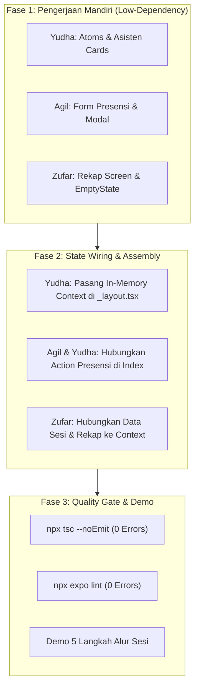

# Panduan Programmer & Pembagian Tugas (Sprint 1)
## Proyek: LabSync - Antarmuka dan Alur Praktikum
### Arsitektur Low-Dependency, Manajemen Ketergantungan, & Jobdesk Tim

---

## 1. Filosofi Arsitektur: Low-Dependency & Zero-Conflict

Untuk memastikan 3 orang programmer (**Yudha**, **Agil**, dan **Zufar**) dapat bekerja serentak secara paralel tanpa saling tunggu (*blocking*) dan tanpa konflik penggabungan kode (*git merge conflict*), proyek LabSync Sprint 1 menerapkan prinsip:

1. **Contract-First Development**:
   - Seluruh kontrak tipe data TypeScript (`src/types/`) dan dataset inisial (`src/constants/dummy-data.ts`) telah didefinisikan secara tuntas di awal proyek.
   - Kontrak ini bersifat *immutable* selama Sprint 1. Tidak ada programmer yang boleh mengubah nama properti tanpa persetujuan tim.
2. **Component Isolation & Pure Props Pattern**:
   - Setiap komponen UI dibuat sebagai *presentational component* murni yang menerima data melalui `props` dan mengirimkan aksi melalui *callback functions* (misal: `onPress`, `onSubmit`, `onConfirm`).
   - Setiap programmer **dapat langsung menguji tampilannya sendiri (Sandbox Testing)** hanya dengan mengoper data dummy lokal pada props, tanpa menunggu state global atau layar programmer lain selesai.
3. **Strict Physical File Ownership**:
   - Setiap programmer memiliki direktori dan berkas eksklusifnya masing-masing.
   - Larangan keras mengedit berkas milik programmer lain sebelum fase integrasi resmi.

---

## 2. Peta Analisis Ketergantungan Antar Programmer (Dependency Analysis)

Tabel berikut memetakan potensi ketergantungan antar programmer beserta strategi mitigasinya:

| Hubungan | Modul Terkait | Jenis Dependensi | Tingkat | Solusi & Strategi Mitigasi (Low-Dependency) |
| :--- | :--- | :--- | :--- | :--- |
| **Agil -> Yudha** | `StatusBadge.tsx` & `ConfirmationModal.tsx` | *Shared Atom UI* | **Rendah** | Yudha menyelesaikan Task Y1 (Shared Atoms) di jam pertama. Sebelum atom siap, Agil dapat menggunakan `Text` atau `View` sederhana sebagai *placeholder* tanpa terhenti. |
| **Zufar -> Yudha** | `Session` Data & Status Sesi | *Data Contract* | **Nol (Telah Dimigrasi)** | Zufar membaca tipe `Session` langsung dari `src/types/session.ts` yang sudah terkunci di awal, bukan dari kode Yudha. |
| **Zufar -> Agil** | `AttendanceRecord` Data | *Data Contract* | **Nol (Telah Dimigrasi)** | Zufar menggunakan tipe `AttendanceRecord` dari `src/types/attendance.ts` dan mock data `INITIAL_ATTENDANCES`. Zufar tidak perlu menunggu form presensi Agil selesai untuk membangun layar rekapitulasi. |
| **Semua -> Yudha** | `LabSyncContext.tsx` / Root State | *State Integration* | **Sedang (Fase Akhir)** | Selama masa pengerjaan, masing-masing programmer mengelola *local state* di layarnya sendiri. Penggabungan ke *shared context* dilakukan pada **Tahap Integrasi Akhir** dipimpin oleh Yudha. |

---

## 3. Matriks Kepemilikan Berkas (*File Ownership Matrix*)

Setiap programmer bertanggung jawab penuh atas berkas-berkas berikut:

```
src/
├── types/                           # [SHARED CONTRACTS - FREEZE]
│   ├── user.ts                      # Kontrak UserProfile & UserRole (Yudha)
│   ├── session.ts                   # Kontrak Session & SessionStatus (Yudha)
│   └── attendance.ts                # Kontrak AttendanceRecord (Agil)
├── constants/
│   └── dummy-data.ts                # [SHARED SEED DATA] (Bersama)
├── components/
│   ├── common/                      # [SHARED ATOMS]
│   │   ├── StatusBadge.tsx          # Milik YUDHA
│   │   ├── ConfirmationModal.tsx    # Milik YUDHA
│   │   ├── RoleSwitcher.tsx         # Milik YUDHA
│   │   └── EmptyState.tsx           # Milik ZUFAR
│   ├── asisten/                     # [MODUL ASISTEN]
│   │   ├── SessionCard.tsx          # Milik YUDHA
│   │   └── SessionControlAction.tsx # Milik YUDHA
│   ├── praktikan/                   # [MODUL PRAKTISAN]
│   │   ├── SessionPraktikanCard.tsx # Milik AGIL
│   │   ├── AttendanceFormModal.tsx  # Milik AGIL
│   │   └── AttendanceFeedbackModal.tsx # Milik AGIL
│   └── rekap/                       # [MODUL REKAPITULASI]
│       ├── AttendanceListItem.tsx   # Milik ZUFAR
│       └── AttendanceSummaryCard.tsx# Milik ZUFAR
└── app/                             # [EXPO ROUTER SCREENS]
    ├── _layout.tsx                  # Root Shell & Provider (YUDHA)
    ├── index.tsx                    # Beranda & Jadwal (YUDHA)
    ├── rekap/
    │   └── [id].tsx                 # Layar Rekap Asisten (ZUFAR)
    └── history.tsx                  # Layar Riwayat Praktikan (ZUFAR)
```

---

## 4. Pembagian Tugas Rinci Programmer (Jobdesk)

### 👨‍💻 Programmer 1: Yudha (Lead Shell & Asisten Control)
- **Fokus Utama**: Arsitektur navigasi root, komponen pemilihan peran (*Role Switcher*), komponen atom bersama, dan kontrol sesi praktikum sisi Asisten.
- **Ketergantungan**: Rendah. Bertindak sebagai penyedia fondasi awal.
- **Daftar Tugas**:
  - [ ] **Task Y1 (Kontrak Dasar & Shared Atoms)**:
    - Verifikasi file `src/types/user.ts` dan `src/types/session.ts`.
    - Buat `src/components/common/StatusBadge.tsx`: Badge visual adaptif (`TERJADWAL` abu-abu, `DIBUKA` hijau, `SELESAI` merah).
    - Buat `src/components/common/ConfirmationModal.tsx`: Modal pop-up dengan judul, pesan konfirmasi aksi, tombol batal, dan tombol eksekusi berwarna tegas.
    - *Beri tahu Agil & Zufar setelah Task Y1 selesai.*
  - [ ] **Task Y2 (Role & Identity Switcher)**:
    - Buat `src/components/common/RoleSwitcher.tsx`:
      - Segmented toggle peran: `Asisten` vs `Praktikan`.
      - Dropdown/pilihan identitas dummy praktikan aktif (Agil vs Zufar).
  - [ ] **Task Y3 (Manajemen Sesi Asisten)**:
    - Buat `src/components/asisten/SessionCard.tsx`: Kartu sesi memuat info mata kuliah, kelas, lab, jam, dan status badge.
    - Buat `src/components/asisten/SessionControlAction.tsx`: Tombol aksi "Buka Sesi" (jika terjadwal) dan "Tutup Sesi" (jika dibuka) yang memanggil `ConfirmationModal`.
  - [ ] **Task Y4 (Layar Beranda & Root Navigation)**:
    - Sempurnakan `src/app/_layout.tsx` dan `src/app/index.tsx`.
    - Tampilkan header dengan `RoleSwitcher` dan daftar sesi praktikum.
    - Sediakan tombol navigasi menuju rekapitulasi bagi Asisten.

---

### 👨‍💻 Programmer 2: Agil (Praktikan Experience & Presensi Anti-Ganda)
- **Fokus Utama**: Antarmuka sesi praktikan, modal form presensi mandiri, validasi pencegahan presensi ganda, dan feedback konfirmasi kehadiran.
- **Ketergantungan**:
  - *Dependensi ke Yudha*: Menggunakan `StatusBadge.tsx` jika sudah siap. Jika belum siap, gunakan `View` dan `Text` sementara agar pengerjaan tidak terhenti.
- **Daftar Tugas**:
  - [ ] **Task A1 (Kontrak Presensi)**:
    - Verifikasi `src/types/attendance.ts` (`AttendanceRecord` & `AttendancePayload`).
  - [ ] **Task A2 (Kartu Sesi Praktikan)**:
    - Buat `src/components/praktikan/SessionPraktikanCard.tsx`:
      - Menampilkan informasi sesi praktikum dari sudut pandang mahasiswa.
      - Logika tombol "Lakukan Presensi":
        - Aktif jika status sesi `DIBUKA` dan praktikan belum presensi.
        - Non-aktif (*disabled*) jika status `TERJADWAL` (label: *"Sesi Belum Dibuka"*).
        - Non-aktif (*disabled*) jika status `SELESAI` (label: *"Sesi Selesai"*).
        - Label *"Sudah Presensi"* (warna hijau) jika mahasiswa sudah tercatat hadir pada sesi tersebut.
  - [ ] **Task A3 (Formulir Presensi Modal)**:
    - Buat `src/components/praktikan/AttendanceFormModal.tsx`:
      - Modal form dengan input: NIM, Nama Mahasiswa (terisi otomatis dari identitas aktif), dan Catatan Opsional (nomor meja/PC).
      - Validasi input tidak boleh kosong.
      - Tata letak menggunakan Flexbox & StyleSheet.
  - [ ] **Task A4 (Validasi Anti-Ganda & Feedback Modal)**:
    - Implementasikan pengecekan validasi: Jika mahasiswa dengan NIM tersebut sudah presensi pada sesi terpilih, cegah pengiriman dan tampilkan alert ramah.
    - Buat `src/components/praktikan/AttendanceFeedbackModal.tsx`: Modal sukses berisi ucapan selamat, stempel jam presensi, dan tombol tutup.

---

### 👨‍💻 Programmer 3: Zufar (Rekapitulasi Kehadiran & Riwayat)
- **Fokus Utama**: Tampilan rekapitulasi daftar hadir per sesi untuk asisten, layar riwayat kehadiran pribadi untuk praktikan, dan komponen penanganan data kosong (*Empty State*).
- **Ketergantungan**:
  - *Dependensi ke Agil*: Membutuhkan tipe data `AttendanceRecord`. Sudah terisolasi karena kontrak tipe data sudah disepakati di `src/types/attendance.ts`.
  - *Dependensi ke Yudha*: Komponen `EmptyState.tsx` dibuat mandiri oleh Zufar, sehingga Zufar dapat bekerja 100% independen tanpa menunggu Yudha.
- **Daftar Tugas**:
  - [ ] **Task Z1 (Universal Empty State Component)**:
    - Buat `src/components/common/EmptyState.tsx`: Komponen fleksibel memuat ikon, judul pesan kosong, dan teks instruksi (contoh: *"Belum ada mahasiswa yang hadir"*).
    - Komponen ini dapat dipakai bersama oleh seluruh anggota tim.
  - [ ] **Task Z2 (Item & Metrik Rekapitulasi Sisi Asisten)**:
    - Buat `src/components/rekap/AttendanceListItem.tsx`: Kartu baris mahasiswa menampilkan avatar inisial, Nama Lengkap, NIM, Waktu Check-in, dan Catatan PC.
    - Buat `src/components/rekap/AttendanceSummaryCard.tsx`: Kartu ringkasan metrik (misal: *"Total Hadir: 1 Mahasiswa"*).
  - [ ] **Task Z3 (Layar Rekapitulasi Sesi Asisten)**:
    - Buat `src/app/rekap/[id].tsx`:
      - Header detail sesi (nama praktikum, kelas, ruang lab, asisten).
      - `FlatList` / `ScrollView` daftar mahasiswa hadir menggunakan `AttendanceListItem`.
      - Tampilkan `EmptyState` jika daftar hadir masih kosong (0 mahasiswa).
      - Tombol kembali ke halaman utama (*Back navigation*).
  - [ ] **Task Z4 (Layar Catatan Riwayat Praktikan)**:
    - Buat `src/app/history.tsx`:
      - Menampilkan daftar kehadiran khusus untuk praktikan yang sedang aktif.
      - Menampilkan tanggal, jam presensi, dan status kehadiran.

---

## 5. Prosedur Integrasi Tanpa Hambatan (Integration Protocol)

Setelah seluruh programmer menyelesaikan komponen mandirinya, ikuti 3 langkah integrasi berikut:



### Langkah Uji Alur Demonstrasi 5 Tahap:
1. **Langkah 1 (Asisten)**: Beralih ke peran *Asisten* -> Pilih sesi 'Pemrograman Mobile' (`TERJADWAL`) -> Klik *Buka Sesi* -> Konfirmasi -> Status berubah jadi `DIBUKA`.
2. **Langkah 2 (Praktikan)**: Beralih ke peran *Praktikan (Agil)* -> Klik *Lakukan Presensi* -> Isi form -> Submit -> Modal sukses muncul dengan stempel jam.
3. **Langkah 3 (Validasi Anti-Ganda)**: Coba kirim presensi lagi dengan akun Agil -> Sistem menolak dan memberitahukan bahwa praktikan sudah hadir.
4. **Langkah 4 (Asisten Rekap & Tutup)**: Beralih kembali ke *Asisten* -> Buka layar *Rekap Kehadiran* -> Nama Agil terlihat di rekap -> Asisten klik *Tutup Sesi* -> Konfirmasi -> Status berubah jadi `SELESAI`.
5. **Langkah 5 (Praktikan Riwayat)**: Beralih ke *Praktikan* -> Tombol presensi telah terkunci (*disabled*) -> Buka layar *Riwayat Saya* -> Kehadiran terverifikasi.

---

## 6. Standar Teknis & Quality Gate

Sebelum menyatakan tugas selesai, setiap programmer wajib memverifikasi:
1. Tidak ada hardcoded style inline berulang; gunakan `StyleSheet.create`.
2. Gunakan Flexbox murni (`flex`, `flexDirection`, `justifyContent`, `alignItems`).
3. Jalankan typecheck: `npx tsc --noEmit`.
4. Jalankan linter: `npx expo lint`.
