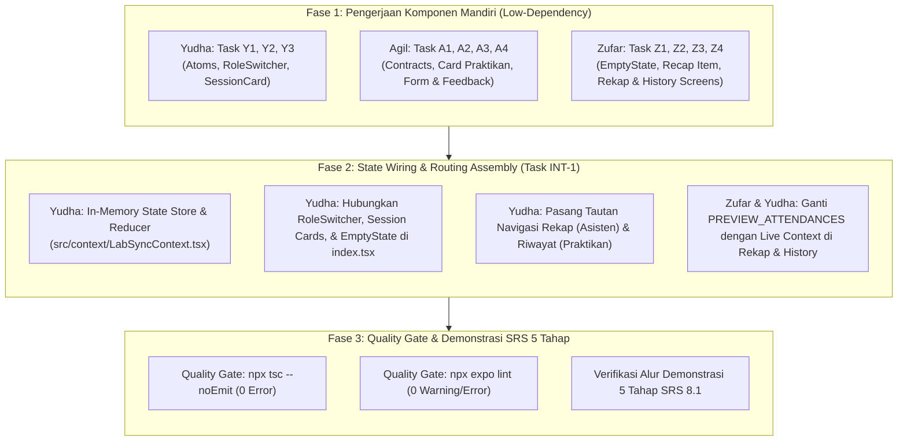

# Panduan Programmer & Pembagian Tugas (Sprint 1)
## Proyek: LabSync - Antarmuka dan Alur Praktikum
### Arsitektur Low-Dependency, Master Matrix, Branching Workflow, & Quality Gate

---

## 1. Konvensi Branch Resmi & Git Workflow

Untuk mencegah konflik penggabungan kode (*git merge conflict*) dan menjamin keterlacakan (*traceability*) dari kebutuhan sistem hingga kode sumber, seluruh anggota tim (**Yudha**, **Agil**, dan **Zufar**) **wajib** mematuhi satu standar konvensi branch dan alur kerja Git berikut.

### 1.1 Format Penamaan Branch Resmi
Setiap branch fitur harus menggunakan pola baku:

```text
feat/<task-id>-<short-description>
```

**Ketentuan Penamaan**:
- Huruf kecil seluruhnya (*lowercase*).
- Deskripsi menggunakan tanda hubung (*kebab-case*), maksimal 3–4 kata ringkas.
- **Satu branch menangani satu task yang terdefinisi secara spesifik**.
- Task ID harus unik, konsisten, dan terdaftar pada Master Matrix (contoh: `y1`, `y2`, `y3`, `y4`, `a1`, `a2`, `a3`, `a4`, `z1`, `z2`, `z3`, `z4`, `int1`).
- **DILARANG KERAS** membuat branch permanen atau branch fitur berdasarkan nama programmer (misalnya: `feat/zufar-recap-history` atau `feat/agil-dev` adalah pelanggaran standar).

**Contoh Nama Branch Resmi**:
- `feat/y1-shared-ui-components`
- `feat/y2-role-switcher`
- `feat/y3-session-controls`
- `feat/y4-home-and-navigation`
- `feat/a1-attendance-contract`
- `feat/a2-session-praktikan-card`
- `feat/a3-attendance-form-modal`
- `feat/a4-anti-duplicate-feedback`
- `feat/z1-empty-state`
- `feat/z2-recap-components`
- `feat/z3-session-recap-screen`
- `feat/z4-personal-attendance-history`
- `feat/int1-state-wiring-assembly`

### 1.2 Alur Kerja Git (Branch, Commit, Review, Merge, & Resolusi Konflik)
1. **Pencabangan (*Branching*)**:
   - Selalu buat branch baru dari commit terbaru branch `main`:
     ```bash
     git checkout main
     git pull origin main
     git checkout -b feat/<task-id>-<short-description>
     ```
2. **Komitmen Atomik (*Atomic Commit*)**:
   - Terapkan standar *Conventional Commits*: `feat(...)`, `fix(...)`, `chore(...)`, `test(...)`.
   - Hanya commit berkas yang termasuk dalam kepemilikan task bersangkutan.
3. **Peninjauan Kode (*Peer Review / Pull Request*)**:
   - Buka Pull Request (PR) ke `main` dengan judul mencantumkan Task ID: `[<TASK-ID>] <Deskripsi Singkat>`.
   - Wajib melampirkan checklist verifikasi (typecheck & lint). Minimal 1 programmer lain melakukan review sebelum merge.
4. **Penggabungan (*Merge Strategy*)**:
   - Penggabungan ke `main` menggunakan metode *Squash and Merge* atau *Rebase Merge* untuk menjaga riwayat git tetap linear dan bersih.
5. **Resolusi Konflik (*Conflict Resolution*)**:
   - Jika branch tertinggal dari `main`, lakukan rebase: `git fetch origin && git rebase origin/main`.
   - Jika terjadi konflik pada berkas milik programmer lain, **dilarang melakukan *force overwrite***. Wajib berkoordinasi langsung dengan pemilik berkas (*file owner*).

---

## 2. Master Traceability & Ownership Matrix

Tabel master ini merekam seluruh penugasan kerja Sprint 1 untuk Yudha, Agil, dan Zufar, menghubungkan setiap kebutuhan SRS, tanggung jawab berkas, dependensi, kriteria keberterimaan, dan status pengerjaan saat ini.

| Task ID | Programmer | Ownership | Branch Name | Task / User Story | Requirement ID | File Ownership | Dependency | Deliverable | Acceptance Criteria | Verification | Status |
| :--- | :--- | :--- | :--- | :--- | :--- | :--- | :--- | :--- | :--- | :--- | :--- |
| **Y1** | Yudha | Yudha | `feat/y1-shared-ui-components` | Fondasi bersama, kontrak dasar User & Session, dan shared atom components | FR-01, FR-03, FR-04, NFR-02, NFR-04 | `src/types/user.ts`<br>`src/types/session.ts`<br>`src/components/common/StatusBadge.tsx`<br>`src/components/common/ConfirmationModal.tsx` | Tidak ada (Fondasi Awal) | Kontrak tipe data `Session` & `UserProfile`, komponen atom badge status adaptif, dan modal konfirmasi aksi kritis | Badge menampilkan warna dan ikon sesuai status sesi (`TERJADWAL`, `DIBUKA`, `SELESAI`). Modal konfirmasi memiliki tombol batal dan lanjut dengan touch target ≥ 44dp. | `npx tsc --noEmit`<br>`npx expo lint`<br>Render visual atom | **Done** *(Merged di PR #4)* |
| **Y2** | Yudha | Yudha | `feat/y2-role-switcher` | **US-05**: Pemilihan Peran & Simulasi Identitas Aktif | FR-02, BR-01, BR-06, NFR-02 | `src/components/common/RoleSwitcher.tsx` | Task Y1 | Komponen *segmented toggle* peran (`ASISTEN` vs `PRAKTISAN`) dan selector identitas dummy praktikan | Peralihan peran mengubah konteks identitas aktif seketika tanpa me-reload aplikasi. Tampilan toggle responsif. | `npx tsc --noEmit`<br>`npx expo lint`<br>Uji interaksi toggle | **In Review** *(Tersedia di branch Y2)* |
| **Y3** | Yudha | Yudha | `feat/y3-session-controls` | **US-02**: Kartu Jadwal Asisten & Kontrol Pembukaan/Penutupan Sesi | FR-01, FR-03, FR-04, BR-01, BR-04, BR-05, TC-02, TC-03 | `src/components/asisten/SessionCard.tsx`<br>`src/components/asisten/SessionControlAction.tsx` | Task Y1 | Kartu sesi asisten memuat metadata lab dan tombol aksi Buka/Tutup Sesi terintegrasi modal | Tombol "Buka Sesi" hanya aktif saat `TERJADWAL`; tombol "Tutup Sesi" hanya aktif saat `DIBUKA`; aksi memicu `ConfirmationModal` sebelum mutasi state. | `npx tsc --noEmit`<br>`npx expo lint`<br>Uji klik modal | **In Review** *(Tersedia di branch Y3)* |
| **Y4** | Yudha | Yudha | `feat/y4-home-and-navigation` | **US-01, US-05**: Layar Beranda, Navigasi Root, In-Memory Store, & Tautan Navigasi | FR-01, FR-02, FR-08, FR-09, FR-10, NFR-01, NFR-03, NFR-05 | `src/app/_layout.tsx`<br>`src/app/index.tsx`<br>`src/constants/dummy-data.ts`<br>`src/context/LabSyncContext.tsx` | Task Y1, Y2, Y3, A2, Z1 | Shell aplikasi Expo Router, header beranda dengan RoleSwitcher, daftar kartu sesi reaktif, seed dataset inisial, dan penyedia context in-memory | Beranda merender daftar sesi sesuai peran aktif; menyediakan tombol navigasi ke Rekapitulasi (Asisten) dan Riwayat Presensi (Praktikan); menampilkan `EmptyState` jika jadwal kosong. | `npx tsc --noEmit`<br>`npx expo lint`<br>Uji alur routing | **In Review** *(Perlu integrasi link riwayat)* |
| **A1** | Agil | Agil | `feat/a1-attendance-contract` | Kontrak tipe data presensi praktikan | FR-05, NFR-04 | `src/types/attendance.ts` | Tidak ada | Interface TypeScript `AttendanceRecord` dan `AttendancePayload` | Tipe data memuat `id`, `sessionId`, `studentId`, `studentName`, `className`, `checkInTime`, dan `notes`. Lolos strict typecheck. | `npx tsc --noEmit` | **Done** *(Merged di PR #1)* |
| **A2** | Agil | Agil | `feat/a2-session-praktikan-card` | **US-01, US-03**: Kartu Jadwal Praktikan dengan Aksi Presensi Adaptif | FR-01, FR-05, BR-02, TC-01, TC-06 | `src/components/praktikan/SessionPraktikanCard.tsx` | Task Y1, A1 | Kartu sesi praktikan dengan validasi status tombol presensi | Tombol "Lakukan Presensi" aktif jika sesi `DIBUKA` & belum hadir; disabled dengan label penjelas jika `TERJADWAL` / `SELESAI`; label hijau *"Sudah Presensi"* jika telah presensi. | `npx tsc --noEmit`<br>`npx expo lint`<br>Uji status tombol | **Done** *(Merged di PR #9)* |
| **A3** | Agil | Agil | `feat/a3-attendance-form-modal` | **US-03**: Formulir Modal Input Presensi Mandiri | FR-05, BR-02, NFR-02, NFR-05, TC-04 | `src/components/praktikan/AttendanceFormModal.tsx` | Task A1 | Modal form presensi dengan input NIM, Nama (prefilled), Catatan PC, dan validasi | Field NIM dan Nama tidak boleh kosong; input form terlindungi `KeyboardAvoidingView`; aksi submit memicu callback dengan payload lengkap. | `npx tsc --noEmit`<br>`npx expo lint`<br>Uji input keyboard | **Done** *(Merged di PR #3)* |
| **A4** | Agil | Agil | `feat/a4-anti-duplicate-feedback` | **US-03**: Validasi Presensi Ganda & Modal Konfirmasi Kehadiran | FR-06, FR-07, BR-03, TC-04, TC-05 | `src/components/praktikan/AttendanceFeedbackModal.tsx` | Task A1 | Helper anti-duplikasi (`isDuplicateAttendance`) dan modal feedback sukses/peringatan presensi | Jika NIM sudah hadir pada sesi sama, tolak presensi & tampilkan peringatan ramah; jika sukses, tampilkan modal centang hijau dengan stempel waktu `HH:mm:ss`. | `npx tsc --noEmit`<br>`npx expo lint`<br>Uji validasi duplikat | **Done** *(Merged di PR #2)* |
| **Z1** | Zufar | Zufar | `feat/z1-empty-state` | **US-01, US-04**: Komponen Universal Penanganan Data Kosong | FR-10, NFR-02, NFR-03 | `src/components/common/EmptyState.tsx` | Tidak ada | Komponen *reusable* `EmptyState` berisi ilustrasi visual, judul kondisi kosong, dan teks panduan | Komponen fleksibel menerima kustomisasi props ikon/judul/deskripsi; tidak menyebabkan crash saat render data kosong. | `npx tsc --noEmit`<br>`npx expo lint`<br>Uji render empty state | **In Review** *(Tersedia di branch Zufar)* |
| **Z2** | Zufar | Zufar | `feat/z2-recap-components` | **US-04**: Komponen Baris Rekapitulasi & Metrik Ringkasan Kehadiran | FR-08, BR-06, NFR-02 | `src/components/rekap/AttendanceListItem.tsx`<br>`src/components/rekap/AttendanceSummaryCard.tsx` | Task A1 | Item baris daftar mahasiswa hadir (avatar, NIM, jam presensi, catatan PC) dan kartu total hadir | Merender avatar inisial 2 kata, nama lengkap tanpa pemotongan, jam format `HH:mm:ss`, catatan PC opsional, dan kartu total mahasiswa hadir. | `npx tsc --noEmit`<br>`npx expo lint`<br>Uji render props | **In Review** *(Tersedia di branch Zufar)* |
| **Z3** | Zufar | Zufar | `feat/z3-session-recap-screen` | **US-04**: Layar Rekapitulasi Presensi Sesi Asisten | FR-08, FR-10, BR-06, TC-07 | `src/app/rekap/[id].tsx`<br>`src/components/rekap/SessionRecap.tsx` | Task Y1, A1, Z1, Z2 | Layar detail rekap presensi per sesi dengan proteksi hak akses Asisten dan tombol kembali | Menampilkan header sesi, daftar kehadiran mahasiswa, `EmptyState` jika 0 hadir, kontrol sesi terintegrasi, dan tombol navigasi kembali (target ≥ 44dp). | `npx tsc --noEmit`<br>`npx expo lint`<br>Uji navigasi layar | **In Review** *(Tersedia di branch Zufar)* |
| **Z4** | Zufar | Zufar | `feat/z4-personal-attendance-history` | **US-04**: Layar Catatan Riwayat Presensi Pribadi Praktikan | FR-09, FR-10, BR-06, TC-08 | `src/app/history.tsx`<br>`src/components/rekap/AttendanceHistory.tsx` | Task Y1, A1, Z1 | Layar riwayat presensi yang terfilter khusus untuk NIM praktikan yang sedang aktif | Menampilkan daftar riwayat terurut waktu, tanggal sesi, jam check-in, status hadir, dan `EmptyState` jika mahasiswa belum memiliki riwayat. | `npx tsc --noEmit`<br>`npx expo lint`<br>Uji filter NIM | **In Review** *(Tersedia di branch Zufar)* |
| **INT-1** | Yudha | Yudha (Lead) | `feat/int1-state-wiring-assembly` | Integrasi Akhir Alur Demonstrasi 5 Tahap, Assembly State Store, & Quality Gate | Seluruh FR (FR-01 s/d FR-10), BR (01-06), NFR (01-05), TC (01-09) | `src/app/index.tsx`<br>`src/context/LabSyncContext.tsx`<br>`src/app/rekap/[id].tsx`<br>`src/app/history.tsx` | Seluruh Task (Y1-Y4, A1-A4, Z1-Z4) | Aplikasi terintegrasi penuh tanpa rute dummy/preview, data presensi reaktif runtime, lolos uji end-to-end 5 tahap | Seluruh alur demonstrasi 5 tahap (Buka sesi -> Presensi -> Tolak duplikat -> Rekap & Tutup -> Verifikasi riwayat) berjalan mulus dalam satu perangkat. | `npx tsc --noEmit`<br>`npx expo lint`<br>Demo 5 Tahap Lulus | **Planned** *(Menunggu penyatuan branch)* |

> [!NOTE]
> **Status Task** (`Done`, `In Review`, `In Progress`, `Planned`, `Blocked`) di atas adalah metadata operasional manajemen proyek, bukan status operasional sesi praktikum aplikasi (`TERJADWAL`, `DIBUKA`, `SELESAI`).

---

## 3. Matriks Kepemilikan Berkas (*Physical File Ownership & No-Overlap Rule*)

Untuk menjamin ketiadaan konflik penggabungan kode, setiap berkas dalam proyek memiliki **satu *Primary Owner*** mutlak.

```
src/
├── types/                                   # [SHARED CONTRACTS - IMMUTABLE / FREEZE]
│   ├── user.ts                              # Owner: YUDHA (Tipe UserProfile & UserRole)
│   ├── session.ts                           # Owner: YUDHA (Tipe Session & SessionStatus)
│   └── attendance.ts                        # Owner: AGIL (Tipe AttendanceRecord & Payload)
├── constants/
│   ├── labsync-theme.ts                     # Owner: YUDHA (Token Desain Bersama)
│   └── dummy-data.ts                        # Owner: YUDHA (Seed Inisial User, Sesi, & Presensi)
├── context/
│   └── LabSyncContext.tsx                   # Owner: YUDHA (State Store In-Memory & Actions)
├── components/
│   ├── common/                              # [SHARED ATOMS]
│   │   ├── StatusBadge.tsx                  # Owner: YUDHA
│   │   ├── ConfirmationModal.tsx            # Owner: YUDHA
│   │   ├── RoleSwitcher.tsx                 # Owner: YUDHA
│   │   └── EmptyState.tsx                   # Owner: ZUFAR
│   ├── asisten/                             # [MODUL ASISTEN]
│   │   ├── SessionCard.tsx                  # Owner: YUDHA
│   │   └── SessionControlAction.tsx         # Owner: YUDHA
│   ├── praktikan/                           # [MODUL PRAKTISAN]
│   │   ├── SessionPraktikanCard.tsx         # Owner: AGIL
│   │   ├── AttendanceFormModal.tsx          # Owner: AGIL
│   │   └── AttendanceFeedbackModal.tsx      # Owner: AGIL
│   └── rekap/                               # [MODUL REKAPITULASI]
│       ├── AttendanceListItem.tsx           # Owner: ZUFAR
│       ├── AttendanceSummaryCard.tsx        # Owner: ZUFAR
│       ├── SessionRecap.tsx                 # Owner: ZUFAR
│       └── AttendanceHistory.tsx            # Owner: ZUFAR
└── app/                                     # [EXPO ROUTER SCREENS]
    ├── _layout.tsx                          # Owner: YUDHA (Root Navigator & Provider)
    ├── index.tsx                            # Owner: YUDHA (Beranda, Role Switcher, & Jadwal)
    ├── rekap/
    │   └── [id].tsx                         # Owner: ZUFAR (Layar Rekapitulasi Sesi Asisten)
    └── history.tsx                          # Owner: ZUFAR (Layar Riwayat Pribadi Praktikan)
```

### Aturan Ketat No-Overlap (*No-Overlap Discipline*):
1. **Aturan Kepemilikan Tunggal**: Satu berkas hanya boleh diedit oleh *Primary Owner*-nya. Programmer lain berstatus sebagai *consumer* yang mengimpor komponen/tipe tersebut.
2. **Larangan Duplikasi Implementasi**: Dilarang membuat berkas tiruan atau komponen salinan (seperti duplikasi route, sandbox berulang, atau mock context terpisah) demi menghindari koordinasi dependensi.
3. **Koordinasi Integrasi File Shell**: Penyesuaian pada `src/app/index.tsx` dan `src/app/_layout.tsx` adalah wewenang **Yudha**. Agil dan Zufar menyerahkan antarmuka melalui ekspor komponen modul masing-masing.

---

## 4. Manajemen Ketergantungan (*Dependency Management*) & Protokol "Blocked"

### 4.1 Tabel Pemetaan Dependensi

| Consumer (Pemanggil) | Dependensi yang Dibutuhkan | Owner Dependensi | Skenario Jika Dependensi Belum Tersedia | Mitigasi Low-Dependency |
| :--- | :--- | :--- | :--- | :--- |
| **Agil** (`SessionPraktikanCard`) | `StatusBadge.tsx` | **Yudha** | Gunakan placeholder `View` & `Text` berlabel sederhana secara lokal tanpa mengubah props interface. | Agil tetap dapat menyelesaikan tata letak dan tombol presensi. |
| **Zufar** (`rekap/[id].tsx`, `history.tsx`) | `AttendanceRecord` contract | **Agil** | **Wajib Blocked** jika kontrak tipe berubah; gunakan tipe yang sudah dibekukan di `src/types/attendance.ts`. | Kontrak sudah dibekukan sejak awal Sprint; risiko blocking nol. |
| **Zufar** (`SessionRecap.tsx`) | `SessionControlAction.tsx` | **Yudha** | Sediakan slot props opsional `sessionControls?: ReactNode` pada komponen rekap. | Zufar dapat menguji tampilan rekap secara penuh menggunakan mock callback. |
| **Yudha** (`src/app/index.tsx`) | `SessionPraktikanCard`, `EmptyState` | **Agil**, **Zufar** | Render kontainer `FlatList` dengan fallback sederhana sebelum komponen modul siap di-import. | Yudha dapat menyelesaikan `RoleSwitcher` dan layout beranda secara paralel. |
| **Seluruh Tim** (Semua Layar) | `LabSyncContext.tsx` | **Yudha** | Komponen UI dibangun sebagai *Pure Presentational Components* dengan props murni (Sandbox Props Testing). | Masing-masing programmer dapat memverifikasi UI secara mandiri tanpa menunggu global state. |

### 4.2 Prosedur Resmi Ketika Dependency Belum Tersedia (*Blocked Protocol*)
Apabila seorang programmer terhambat oleh pekerjaan programmer lain yang belum selesai:
1. **Tandai Task sebagai `Blocked`**: Perbarui status pada catatan koordinasi tim / PR.
2. **Catat Bukti Ketergantungan**: Cantumkan berkas, tipe data, atau fungsi yang belum tersedia secara spesifik.
3. **Hubungi Owner Dependensi**: Lakukan eskalasi langsung kepada programmer penanggung jawab dan beri tahu Project Manager.
4. **Dilarang Mengubah Kontrak**: **Dilarang keras** membuat kontrak baru, mengganti nama properti interface, atau mengubah tipe data global secara sepihak.
5. **Alihkan ke Task Paralel**: Programmer harus beralih mengerjakan task mandiri lain miliknya yang tidak terblokir (misal: beralih dari layar route ke komponen atom).

---

## 5. Fase Integrasi & Urutan Pelaksanaan (*Phased Assembly*)

Proses pengembangan dibagi menjadi 3 fase terstruktur untuk memastikan integrasi berjalan mulus:



### Urutan Integrasi Final (Task INT-1):
1. **Langkah 1 (Rebase ke Main Terkini)**:
   - Branch Yudha (`feat/y2`, `feat/y3`, `feat/y4`) dan branch Zufar (`feat/z1` s/d `feat/z4`) di-rebase ke `origin/main` yang telah memuat pekerjaan Agil (PR #1, #2, #3, #9).
2. **Langkah 2 (Penyatuan State Store di Root Layout)**:
   - Yudha memasang `LabSyncProvider` di `src/app/_layout.tsx` mengelola state `sessions`, `attendances`, dan `currentUser`.
3. **Langkah 3 (Perakitan Beranda & Penuntasan Gap Navigasi)**:
   - Di `src/app/index.tsx`, Yudha merender:
     - Header `RoleSwitcher`.
     - Daftar sesi adaptif: `SessionCard` (saat Asisten) atau `SessionPraktikanCard` (saat Praktikan).
     - Komponen `EmptyState` jika daftar sesi kosong.
     - **Tautan Navigasi Lengkap**:
       - Tombol menuju `/rekap/[id]` untuk Asisten.
       - **Tombol navigasi menuju `/history` ("Riwayat Kehadiran Saya") untuk Praktikan** *(Penuntasan GAP-01)*.
4. **Langkah 4 (Wiring Modal Presensi Agil)**:
   - Yudha dan Agil menghubungkan event klik kartu praktikan ke pembukaan `AttendanceFormModal` dan `AttendanceFeedbackModal`.
5. **Langkah 5 (Pembersihan Route Dummy Zufar)**:
   - Zufar mencabut data statis `PREVIEW_ATTENDANCES` dan sandbox rute sementara, menggantikannya dengan pembacaan langsung dari context aplikasi.

---

## 6. Definisi Selesai (*Definition of Done - DoD*)

Suatu task **hanya boleh** diubah statusnya menjadi **Done** dan digabungkan ke `main` apabila memenuhi 7 kriteria mutlak berikut:

- [ ] **1. Pemenuhan Kebutuhan & Acceptance Criteria**: Seluruh kriteria fungsional SRS yang terpetakan pada task terpenuhi tanpa cacat logika.
- [ ] **2. Kepatuhan Kepemilikan Berkas (*No Unauthorized Edits*)**: Git diff membuktikan tidak ada modifikasi pada berkas milik programmer lain di luar kesepakatan matriks.
- [ ] **3. Kepatuhan TypeScript Strict**: Lolos uji typecheck tanpa satupun error:
  ```bash
  npx tsc --noEmit
  ```
- [ ] **4. Kepatuhan Standar Linting**: Lolos pemeriksaan linter resmi:
  ```bash
  npx expo lint
  ```
- [ ] **5. Responsivitas Layar & Aksesibilitas**: Antarmuka telah diverifikasi pada resolusi layar mobile minimal 360dp, teks tidak terpotong saat font scaling aktif, dan seluruh tombol interaktif memiliki target sentuh minimal 44x44 dp.
- [ ] **6. Ketiadaan Tombol Dummy**: Seluruh tombol utama memiliki *event handler* aktif (memicu modal, navigasi, atau mutasi state; tidak ada tombol mati).
- [ ] **7. Peninjauan Kode & Integrasi Bersih**: PR telah disetujui (*approved*) oleh minimal satu *reviewer* rekan tim dan lolos penggabungan tanpa konflik ke branch `main`.

---

## 7. Rencana Mitigasi Risiko Overlap & Resolusi Cabang Riil Saat Ini

Berdasarkan audit repositori aktual pada tanggal 25 Oktober 2026, ditemukan kondisi cabang Git yang memerlukan tindakan perapian segera:

1. **Risiko Overlap Branch Zufar (`feat/zufar-recap-history`)**:
   - **Kondisi Lapangan**: Branch Zufar dicabangkan dari commit lama Yudha (`db53c89`) sebelum PR Agil (#1, #2, #3, #9) digabungkan ke `main`. Akibatnya, git diff branch Zufar terhadap `main` mendeteksi penghapusan berkas milik Agil.
   - **Solusi Mitigasi**: Zufar **wajib melakukan rebase** terhadap `origin/main` terbaru:
     ```bash
     git checkout feat/zufar-recap-history
     git fetch origin
     git rebase origin/main
     ```
     Dengan langkah ini, berkas komponen Agil tetap utuh dan komponen Zufar dapat bersanding bersih.
2. **Penyelesaian Gap Navigasi Riwayat Praktikan (`src/app/history.tsx`)**:
   - **Kondisi**: Layar `history.tsx` telah dibangun oleh Zufar, namun tidak memiliki pintu masuk (*entry point*) dari Beranda.
   - **Solusi Mitigasi**: Yudha resmi ditugaskan menyematkan tombol aksi *"Lihat Riwayat Saya"* pada header/footer Beranda saat peran `PRAKTISAN` aktif dalam lingkup Task Y4 / INT-1.
3. **Penyelarasan Nomenklatur Peran `PRAKTISAN`**:
   - Nilai enum TypeScript dibekukan sebagai `'ASISTEN' | 'PRAKTISAN'` sesuai kontrak awal, sedangkan microcopy antarmuka tetap menyajikan istilah ramah pengguna "Praktikan".
