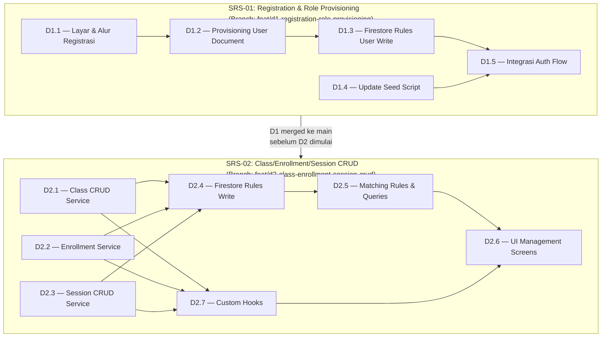

# Panduan Programmer Daniel — Sprint 2
## Proyek: LabSync — Registrasi, Provisioning, Class/Enrollment/Session CRUD & Matching Rules
### Master Traceability Matrix, File Ownership, Branching Strategy & Quality Gate

---

## 1. Konvensi Branch Resmi & Git Workflow Sprint 2

Penugasan Daniel mencakup **dua SRS terpisah** (SRS-01 dan SRS-02). Sesuai arahan tim, **masing-masing SRS dikerjakan di branch yang berbeda** untuk menjaga isolasi fitur, mempermudah review, dan mencegah PR besar (*monolith PR*).

### 1.1 Format Penamaan Branch

```text
feat/<task-id>-<short-description>
```

**Branch Resmi Daniel:**

| Branch | SRS | Cakupan |
| :--- | :--- | :--- |
| `feat/d1-registration-role-provisioning` | SRS-01 | Registrasi akun, pembuatan dokumen `users/{uid}`, provisioning role (`ASISTEN` / `PRAKTISAN`), Firestore rules write, seed script update |
| `feat/d2-class-enrollment-session-crud` | SRS-02 | CRUD kelas, enrollment management, CRUD sesi, matching rules (asisten ↔ kelas, praktikan ↔ enrollment ↔ sesi), Firestore rules & indexes |

> [!CAUTION]
> **DILARANG KERAS** menggabungkan pekerjaan SRS-01 dan SRS-02 dalam satu branch yang sama. Setiap branch ditargetkan ke `main` secara independen melalui PR terpisah. Branch `feat/d1-*` harus sudah di-merge ke `main` sebelum `feat/d2-*` dimulai (karena SRS-02 membutuhkan user document yang sudah ter-provisioning).

### 1.2 Alur Kerja Git

1. **Pencabangan**:
   ```bash
   git checkout main
   git pull origin main
   git checkout -b feat/d1-registration-role-provisioning
   ```
2. **Komit Atomik** — Conventional Commits: `feat(auth): ...`, `feat(firestore): ...`, `test(rules): ...`
3. **Pull Request** — Judul: `[D1] Registration & Role Provisioning` atau `[D2] Class/Enrollment/Session CRUD`
4. **Merge Strategy** — Squash and Merge ke `main`
5. **Urutan Merge**:
   ```
   main ← feat/d1-registration-role-provisioning (PR #1 Daniel)
   main ← feat/d2-class-enrollment-session-crud   (PR #2 Daniel, setelah D1 merged)
   ```

### 1.3 Resolusi Konflik
- Rebase terhadap `origin/main` sebelum membuka PR: `git fetch origin && git rebase origin/main`
- Jika terjadi konflik pada berkas milik programmer lain (Agiel/Zufar), **dilarang force overwrite** — koordinasikan langsung dengan pemilik berkas

---

## 2. Master Traceability & Ownership Matrix

Tabel master ini merekam seluruh penugasan kerja Sprint 2 untuk programmer **Daniel**, menghubungkan setiap kebutuhan SRS, tanggung jawab berkas, dependensi, kriteria keberterimaan, dan status pengerjaan.

### 2.1 SRS-01: Registrasi & Role Provisioning

| Task ID | Branch | Task / Scope | Requirement Ref | File Ownership | Dependency | Deliverable | Acceptance Criteria | Verification | Status |
| :--- | :--- | :--- | :--- | :--- | :--- | :--- | :--- | :--- | :--- |
| **D1.1** | `feat/d1-registration-role-provisioning` | **Layar & Alur Registrasi Akun Baru** — UI form pendaftaran (nama, NIM/kode asisten, email, password), validasi input (Zod schema), pemilihan role | SRS-01, FR-02 (Sprint 1 ref), BR-01 | `src/app/(auth)/register.tsx` *(baru)*<br>`src/services/registration.ts` *(baru)*<br>`src/validations/registration.schema.ts` *(baru)* | Firebase Auth sudah terkonfigurasi di `src/firebase/client.ts` | Layar registrasi fungsional dengan form, validasi, role selector, dan navigasi ke login | User dapat mengisi form → validasi client-side → akun terbuat di Firebase Auth → redirect ke login/dashboard | `npx tsc --noEmit`<br>`npx expo lint`<br>Manual test registrasi | **Planned** |
| **D1.2** | `feat/d1-registration-role-provisioning` | **Provisioning Dokumen User di Firestore** — Setelah Auth berhasil, buat dokumen `users/{uid}` dengan field `name`, `identifier`, `role` sesuai kontrak `UserDocument` | SRS-01, Sprint-2 Contract | `src/services/registration.ts` *(lanjutan D1.1)*<br>`src/firebase/mutations.ts` *(baru — fungsi write Firestore)* | `src/types/sprint2.ts` (kontrak `UserDocument`)<br>`src/types/user.ts` (kontrak `UserProfile`, `UserRole`) | Dokumen user ter-provisioning otomatis di Firestore saat registrasi | Dokumen `users/{uid}` terbuat dengan field yang sesuai kontrak; `role` bernilai `ASISTEN` atau `PRAKTISAN`; tidak ada field tambahan di luar kontrak | `npx tsc --noEmit`<br>Rules unit test | **Planned** |
| **D1.3** | `feat/d1-registration-role-provisioning` | **Firestore Security Rules — User Write** — Rule `allow create` pada path `users/{uid}` memvalidasi: UID match, field wajib, role enum, tidak ada field tambahan | SRS-01, Sprint-2 Contract | `firestore.rules` *(extend bagian `match /users/{uid}`)*<br>`tests/firestore-rules.test.cjs` *(extend test)* | Rule scaffold yang sudah ada di `firestore.rules` L36-38 | Rule create yang aman untuk self-registration | Hanya authenticated user yang bisa membuat dokumen profil sendiri; role harus valid enum; tidak bisa overwrite profil yang sudah ada; test passed | `node --test tests/firestore-rules.test.cjs` | **Planned** |
| **D1.4** | `feat/d1-registration-role-provisioning` | **Update Seed Script** — Tambahkan variasi akun demo (asisten kedua, praktikan kedua) untuk testing SRS-07 nanti | SRS-01, SRS-07 (persiapan) | `scripts/seed-firebase.cjs` *(extend)* | Firestore emulator | Seed script menghasilkan minimal 2 akun per role | `node scripts/seed-firebase.cjs demo-labsync` berhasil tanpa error; akun terverifikasi di emulator | Manual run | **Planned** |
| **D1.5** | `feat/d1-registration-role-provisioning` | **Integrasi Auth Flow** — Hubungkan register → login → dashboard; update `LabSyncContext` agar profile watcher langsung aktif setelah registrasi | SRS-01 | `src/app/(auth)/register.tsx` *(finalisasi)*<br>`src/components/common/FoundationGate.tsx` *(extend — tambah link ke register)* | `src/context/LabSyncContext.tsx` (milik shared, koordinasi) | Alur end-to-end: Register → Auto-login → Profile loaded → Dashboard | User baru langsung masuk dashboard setelah registrasi; `FoundationGate` login screen punya link "Belum punya akun?" ke register | `npx tsc --noEmit`<br>`npx expo lint` | **Planned** |

### 2.2 SRS-02: Class/Enrollment/Session CRUD & Matching Rules

| Task ID | Branch | Task / Scope | Requirement Ref | File Ownership | Dependency | Deliverable | Acceptance Criteria | Verification | Status |
| :--- | :--- | :--- | :--- | :--- | :--- | :--- | :--- | :--- | :--- |
| **D2.1** | `feat/d2-class-enrollment-session-crud` | **Service Layer — Class CRUD** — Fungsi `createClass`, `updateClass`, `deleteClass` untuk path `classes/{classId}` | SRS-02, Sprint-2 Contract | `src/services/classService.ts` *(baru)*<br>`src/firebase/mutations.ts` *(extend)* | D1 merged, `src/types/sprint2.ts` (kontrak `ClassDocument`) | Fungsi CRUD kelas lengkap dengan validasi `assistantUid` | Kelas terbuat dengan `name` dan `assistantUid`; hanya asisten pemilik yang bisa update/delete; operasi gagal jika field tidak valid | `npx tsc --noEmit`<br>Rules unit test | **Planned** |
| **D2.2** | `feat/d2-class-enrollment-session-crud` | **Service Layer — Enrollment Management** — Fungsi `enrollStudent`, `unenrollStudent` untuk path `enrollments/{uid}/classes/{classId}` | SRS-02, Sprint-2 Contract | `src/services/enrollmentService.ts` *(baru)*<br>`src/firebase/mutations.ts` *(extend)* | D1 merged, kontrak `EnrollmentDocument` | Fungsi enrollment/unenrollment dengan timestamp | Enrollment terbuat dengan `enrolledAt` timestamp; student hanya bisa di-enroll sekali per kelas; unenroll menghapus dokumen | `npx tsc --noEmit`<br>Rules unit test | **Planned** |
| **D2.3** | `feat/d2-class-enrollment-session-crud` | **Service Layer — Session CRUD** — Fungsi `createSession`, `updateSession`, `deleteSession` untuk path `sessions/{sessionId}` (ID auto-generated) | SRS-02, Sprint-2 Contract | `src/services/sessionService.ts` *(baru)*<br>`src/firebase/mutations.ts` *(extend)* | D1 merged, kontrak `SessionDocument` | Fungsi CRUD sesi dengan validasi status awal `TERJADWAL` dan field lengkap | Sesi terbuat dengan semua field kontrak; ID auto-generated; status awal `TERJADWAL`; hanya asisten pemilik kelas yang bisa CRUD | `npx tsc --noEmit`<br>Rules unit test | **Planned** |
| **D2.4** | `feat/d2-class-enrollment-session-crud` | **Firestore Security Rules — Class/Enrollment/Session Write** — Rules `create`, `update`, `delete` pada path `classes`, `enrollments`, `sessions` dengan matching rules | SRS-02, Sprint-2 Contract | `firestore.rules` *(extend)*<br>`tests/firestore-rules.test.cjs` *(extend)* | D1.3 rules sudah merged | Rules write yang enforce: asisten hanya kelola kelas sendiri, enrollment hanya oleh trusted code atau asisten kelas, sesi hanya dibuat oleh asisten pemilik kelas | Semua positive & negative test case passed; unauthorized write ditolak; field validation enforce kontrak | `node --test tests/firestore-rules.test.cjs` | **Planned** |
| **D2.5** | `feat/d2-class-enrollment-session-crud` | **Matching Rules & Query Logic** — Validasi hubungan asisten ↔ kelas, praktikan ↔ enrollment ↔ sesi; composite indexes | SRS-02, Sprint-2 Contract | `src/firebase/queries.ts` *(extend — tambah query baru)*<br>`firestore.indexes.json` *(extend)* | D2.1–D2.3, existing queries di `queries.ts` | Query functions: `getClassesByAssistant`, `getEnrollmentsByStudent`, `getSessionsByClass` dengan real-time listener | Query mengembalikan data sesuai scope; composite index terdaftar; query gagal jika user tidak punya akses | `npx tsc --noEmit`<br>Smoke test di emulator | **Planned** |
| **D2.6** | `feat/d2-class-enrollment-session-crud` | **UI Management Screens (Asisten)** — Layar admin untuk manage kelas, enrollment, dan sesi praktikum | SRS-02 | `src/app/(app)/manage/index.tsx` *(baru)*<br>`src/app/(app)/manage/class/[id].tsx` *(baru)*<br>`src/app/(app)/manage/session/create.tsx` *(baru)*<br>`src/components/manage/ClassForm.tsx` *(baru)*<br>`src/components/manage/SessionForm.tsx` *(baru)*<br>`src/components/manage/EnrollmentList.tsx` *(baru)* | D2.1–D2.5 | UI manajemen data lengkap untuk asisten | Asisten dapat: melihat daftar kelas, buat/edit/hapus kelas, kelola enrollment praktikan, buat/edit/hapus sesi | `npx tsc --noEmit`<br>`npx expo lint`<br>Manual test CRUD | **Planned** |
| **D2.7** | `feat/d2-class-enrollment-session-crud` | **Hooks — Custom Hooks untuk Management** — React hooks untuk CRUD operations dengan loading/error state | SRS-02, NFR | `src/hooks/useClasses.ts` *(baru)*<br>`src/hooks/useEnrollments.ts` *(baru)*<br>`src/hooks/useSessionManagement.ts` *(baru)* | D2.1–D2.5 | Hooks yang wrap service functions dengan state management (loading, error, refetch) | Hooks mengembalikan `{ data, loading, error, mutate }` pattern; re-render saat data berubah; error handling graceful | `npx tsc --noEmit` | **Planned** |

---

## 3. Matriks Kepemilikan Berkas (*Physical File Ownership & No-Overlap Rule*)

Untuk menjamin ketiadaan konflik penggabungan kode, setiap berkas dalam proyek memiliki **satu *Primary Owner*** mutlak.

### 3.1 Legenda Kepemilikan

| Simbol | Arti |
| :--- | :--- |
| 🟢 **DANIEL** | Primary Owner — hanya Daniel yang boleh mengedit |
| 🔵 **AGIEL** | Primary Owner — milik Agiel |
| 🟣 **ZUFAR** | Primary Owner — milik Zufar |
| ⚪ **TEAM** | Shared/Koordinasi — edit dengan persetujuan PM atau lead |
| 🔒 **FROZEN** | Kontrak beku Sprint 1 — tidak boleh diubah tanpa konsensus tim |

### 3.2 Peta Kepemilikan File

```
C:\Users\Daniel\LabSync\LabSync\
│
├── firestore.rules                              # 🟢 DANIEL (extend write rules SRS-01/02)
│                                                #   Catatan: rules read existing → FROZEN
│                                                #   Daniel HANYA menambah rules write baru
│                                                #   Agiel menambah attendance/leave write rules
│
├── firestore.indexes.json                       # 🟢 DANIEL (composite indexes untuk SRS-02)
│
├── firebase.json                                # ⚪ TEAM (config, jarang diubah)
│
├── scripts/
│   └── seed-firebase.cjs                        # 🟢 DANIEL (extend seed akun & data demo)
│
├── tests/
│   ├── firestore-rules.test.cjs                 # 🟢 DANIEL (extend test rules write)
│   │                                            #   Agiel menambah test attendance/leave write
│   └── sprint2-web.test.cjs                     # ⚪ TEAM (integration test bersama)
│
├── src/
│   ├── types/                                   # [SHARED CONTRACTS]
│   │   ├── user.ts                              # 🔒 FROZEN (UserProfile, UserRole — Sprint 1)
│   │   ├── session.ts                           # 🔒 FROZEN (Session, SessionStatus — Sprint 1)
│   │   ├── attendance.ts                        # 🔒 FROZEN (AttendanceRecord — Sprint 1)
│   │   └── sprint2.ts                           # 🔒 FROZEN (Kontrak Firestore Sprint 2)
│   │                                            #   Daniel MENGKONSUMSI, tidak mengubah
│   │
│   ├── constants/
│   │   └── labsync-theme.ts                     # 🔒 FROZEN (Token desain bersama)
│   │
│   ├── firebase/
│   │   ├── client.ts                            # ⚪ TEAM (Firebase init — jarang diubah)
│   │   ├── persistence.ts                       # ⚪ TEAM (Auth persistence web)
│   │   ├── persistence.native.ts                # ⚪ TEAM (Auth persistence native)
│   │   ├── queries.ts                           # 🟢 DANIEL (extend query functions SRS-02)
│   │   │                                        #   Catatan: fungsi existing → FROZEN
│   │   │                                        #   Daniel HANYA menambah fungsi baru
│   │   └── mutations.ts                         # 🟢 DANIEL ★ BARU (fungsi write Firestore)
│   │
│   ├── services/                                # [BARU — Service Layer Sprint 2]
│   │   ├── registration.ts                      # 🟢 DANIEL ★ BARU (registrasi & provisioning)
│   │   ├── classService.ts                      # 🟢 DANIEL ★ BARU (Class CRUD)
│   │   ├── enrollmentService.ts                 # 🟢 DANIEL ★ BARU (Enrollment management)
│   │   └── sessionService.ts                    # 🟢 DANIEL ★ BARU (Session CRUD)
│   │
│   ├── validations/                             # [BARU — Zod Schemas]
│   │   └── registration.schema.ts               # 🟢 DANIEL ★ BARU (validasi form register)
│   │
│   ├── hooks/
│   │   ├── use-attendance.ts                    # 🔵 AGIEL (attendance hook — Sprint 2 scaffold)
│   │   ├── useClasses.ts                        # 🟢 DANIEL ★ BARU (hook class management)
│   │   ├── useEnrollments.ts                    # 🟢 DANIEL ★ BARU (hook enrollment management)
│   │   └── useSessionManagement.ts              # 🟢 DANIEL ★ BARU (hook session CRUD)
│   │
│   ├── context/
│   │   └── LabSyncContext.tsx                    # ⚪ TEAM (State store utama)
│   │                                            #   Daniel boleh extend HANYA dengan
│   │                                            #   koordinasi — tambah value baru di
│   │                                            #   LabSyncContextValue interface
│   │
│   ├── components/
│   │   ├── common/                              # [SHARED ATOMS]
│   │   │   ├── ConfirmationModal.tsx            # 🔒 FROZEN (Sprint 1)
│   │   │   ├── EmptyState.tsx                   # 🟣 ZUFAR
│   │   │   ├── FoundationGate.tsx               # ⚪ TEAM → 🟢 DANIEL extend (link register)
│   │   │   └── StatusBadge.tsx                  # 🔒 FROZEN (Sprint 1)
│   │   │
│   │   ├── asisten/                             # [MODUL ASISTEN — Sprint 1]
│   │   │   ├── SessionCard.tsx                  # 🔒 FROZEN
│   │   │   └── SessionControlAction.tsx         # 🔒 FROZEN
│   │   │
│   │   ├── praktikan/                           # [MODUL PRAKTISAN — Sprint 1]
│   │   │   ├── AttendanceFeedbackModal.tsx      # 🔵 AGIEL
│   │   │   ├── AttendanceFormModal.tsx          # 🔵 AGIEL
│   │   │   └── SessionPraktikanCard.tsx         # 🔵 AGIEL
│   │   │
│   │   ├── rekap/                               # [MODUL REKAPITULASI]
│   │   │   ├── AttendanceHistory.tsx            # 🟣 ZUFAR
│   │   │   ├── AttendanceListItem.tsx           # 🟣 ZUFAR
│   │   │   ├── AttendanceScreenHeader.tsx       # 🟣 ZUFAR
│   │   │   ├── AttendanceSummaryCard.tsx        # 🟣 ZUFAR
│   │   │   └── SessionRecap.tsx                 # 🟣 ZUFAR
│   │   │
│   │   └── manage/                              # [BARU — MODUL MANAJEMEN DATA]
│   │       ├── ClassForm.tsx                    # 🟢 DANIEL ★ BARU
│   │       ├── SessionForm.tsx                  # 🟢 DANIEL ★ BARU
│   │       └── EnrollmentList.tsx               # 🟢 DANIEL ★ BARU
│   │
│   └── app/                                     # [EXPO ROUTER SCREENS]
│       ├── _layout.tsx                          # ⚪ TEAM (Root Navigator & Provider)
│       ├── index.tsx                            # ⚪ TEAM (Beranda — Sprint 1)
│       ├── history.tsx                          # 🟣 ZUFAR
│       ├── rekap/
│       │   └── [id].tsx                         # 🟣 ZUFAR
│       │
│       ├── (auth)/                              # [BARU — AUTH SCREENS]
│       │   ├── _layout.tsx                      # 🟢 DANIEL ★ BARU (Auth navigator)
│       │   └── register.tsx                     # 🟢 DANIEL ★ BARU (Layar registrasi)
│       │
│       └── (app)/
│           └── manage/                          # [BARU — MANAGEMENT SCREENS]
│               ├── index.tsx                    # 🟢 DANIEL ★ BARU (Dashboard manajemen)
│               ├── class/
│               │   └── [id].tsx                 # 🟢 DANIEL ★ BARU (Detail/edit kelas)
│               └── session/
│                   └── create.tsx               # 🟢 DANIEL ★ BARU (Buat sesi baru)
│
└── docs/
    └── programmerDaniel.md                      # 🟢 DANIEL (Dokumen ini)
```

### 3.3 Aturan Ketat No-Overlap

1. **Aturan Kepemilikan Tunggal**: Satu berkas hanya boleh diedit oleh *Primary Owner*-nya. Programmer lain berstatus *consumer* yang mengimpor komponen/tipe/fungsi tersebut.

2. **Larangan Modifikasi Kontrak Beku (🔒 FROZEN)**: Berkas di `src/types/` dan komponen Sprint 1 tidak boleh diubah tanpa konsensus seluruh tim dan PM.

3. **Aturan Extend-Only pada File Shared**:
   - `firestore.rules`: Daniel **hanya menambah** rule `allow create/update/delete` baru — **dilarang** mengubah rule read yang sudah ada.
   - `src/firebase/queries.ts`: Daniel **hanya menambah** fungsi query baru — **dilarang** mengubah fungsi `watchProfile`, `watchClassIds`, `watchSessions`, `updateSessionStatus`, `watchAttendance` yang sudah ada.
   - `tests/firestore-rules.test.cjs`: Daniel **hanya menambah** test case baru — **dilarang** mengubah test existing.

4. **Koordinasi File `⚪ TEAM`**: Edit pada `LabSyncContext.tsx`, `_layout.tsx`, `FoundationGate.tsx` wajib dikoordinasikan via chat tim / PR review.

5. **Boundary dengan Agiel**:
   - Agiel menangani `attendance` dan `leaveRequests` write rules & transactions.
   - Daniel **tidak menyentuh** path `attendance/{attendanceId}` dan `leaveRequests/{requestId}` di rules maupun service layer.

6. **Boundary dengan Zufar**:
   - Zufar menangani rekap/history UI dan leave review.
   - Daniel **tidak menyentuh** komponen di `src/components/rekap/` dan routes `history.tsx`, `rekap/[id].tsx`.

---

## 4. Pemetaan Dependensi & Urutan Pengerjaan

### 4.1 Dependency Graph



### 4.2 Tabel Dependensi Antar-Programmer

| Consumer (Daniel) | Dependensi yang Dibutuhkan | Owner | Status | Mitigasi Jika Belum Tersedia |
| :--- | :--- | :--- | :--- | :--- |
| D1.1 (Register screen) | `firebase/client.ts` (Firebase init) | TEAM | ✅ Ready | — |
| D1.2 (User provisioning) | `types/sprint2.ts` (UserDocument) | FROZEN | ✅ Ready | — |
| D1.2 (User provisioning) | `types/user.ts` (UserRole) | FROZEN | ✅ Ready | — |
| D1.3 (Rules write) | `firestore.rules` (existing scaffold) | DANIEL extend | ✅ Ready | — |
| D1.5 (Auth flow) | `context/LabSyncContext.tsx` (profile watcher) | TEAM | ✅ Ready | Watcher `watchProfile` sudah ada; register + auto-login akan langsung trigger watcher |
| D2.1–D2.3 (Service layer) | `types/sprint2.ts` (ClassDocument, EnrollmentDocument, SessionDocument) | FROZEN | ✅ Ready | — |
| D2.5 (Queries) | `firebase/queries.ts` (existing patterns) | DANIEL extend | ✅ Ready | Ikuti pola `watchSessions` yang sudah ada |
| D2.6 (UI) | `ConfirmationModal.tsx`, `EmptyState.tsx`, `StatusBadge.tsx` | FROZEN | ✅ Ready | Gunakan komponen atom yang sudah tersedia |

---

## 5. Ringkasan File Baru yang Harus Dibuat Daniel

### 5.1 Branch `feat/d1-registration-role-provisioning` (SRS-01)

| # | Path File | Jenis | Deskripsi |
| :--- | :--- | :--- | :--- |
| 1 | `src/app/(auth)/register.tsx` | Baru | Layar registrasi akun (form + role picker) |
| 2 | `src/app/(auth)/_layout.tsx` | Baru | Auth group layout navigator |
| 3 | `src/services/registration.ts` | Baru | Logic: Firebase Auth createUser + Firestore user doc |
| 4 | `src/validations/registration.schema.ts` | Baru | Zod schema untuk validasi form registrasi |
| 5 | `src/firebase/mutations.ts` | Baru | Fungsi-fungsi write Firestore (setDoc, updateDoc, deleteDoc) |
| 6 | `firestore.rules` | Extend | Tambah `allow create` pada `match /users/{uid}` |
| 7 | `tests/firestore-rules.test.cjs` | Extend | Tambah test: user self-create, prevent overwrite, field validation |
| 8 | `scripts/seed-firebase.cjs` | Extend | Tambah akun demo kedua per role |
| 9 | `src/components/common/FoundationGate.tsx` | Extend | Tambah link "Daftar Akun Baru" ke register screen |

### 5.2 Branch `feat/d2-class-enrollment-session-crud` (SRS-02)

| # | Path File | Jenis | Deskripsi |
| :--- | :--- | :--- | :--- |
| 1 | `src/services/classService.ts` | Baru | CRUD kelas: create, update, delete |
| 2 | `src/services/enrollmentService.ts` | Baru | Enrollment: enroll, unenroll, list |
| 3 | `src/services/sessionService.ts` | Baru | Session CRUD: create, update, delete |
| 4 | `src/hooks/useClasses.ts` | Baru | Hook class management dengan loading/error state |
| 5 | `src/hooks/useEnrollments.ts` | Baru | Hook enrollment management |
| 6 | `src/hooks/useSessionManagement.ts` | Baru | Hook session CRUD operations |
| 7 | `src/app/(app)/manage/index.tsx` | Baru | Dashboard manajemen (list kelas) |
| 8 | `src/app/(app)/manage/class/[id].tsx` | Baru | Detail kelas + enrollment list |
| 9 | `src/app/(app)/manage/session/create.tsx` | Baru | Form buat sesi baru |
| 10 | `src/components/manage/ClassForm.tsx` | Baru | Form komponen buat/edit kelas |
| 11 | `src/components/manage/SessionForm.tsx` | Baru | Form komponen buat/edit sesi |
| 12 | `src/components/manage/EnrollmentList.tsx` | Baru | List + add/remove enrollment |
| 13 | `src/firebase/queries.ts` | Extend | Tambah query functions untuk class/enrollment/session management |
| 14 | `src/firebase/mutations.ts` | Extend | Tambah fungsi write untuk class/enrollment/session |
| 15 | `firestore.rules` | Extend | Tambah rules write untuk classes, enrollments, sessions |
| 16 | `firestore.indexes.json` | Extend | Composite indexes untuk query baru |
| 17 | `tests/firestore-rules.test.cjs` | Extend | Tambah test rules write class/enrollment/session |

---

## 6. Kontrak Firestore yang Digunakan (Referensi Cepat)

Dikonsumsi dari [src/types/sprint2.ts](file:///C:/Users/Daniel/LabSync/LabSync/src/types/sprint2.ts):

```typescript
// User document di Firestore (tanpa 'id' dan 'className')
export type UserDocument = Omit<UserProfile, 'id' | 'className'>;
// → { name: string; identifier: string; role: UserRole }

export interface ClassDocument {
  name: string;
  assistantUid: string;
}

export interface EnrollmentDocument {
  enrolledAt: Timestamp;
}

export type SessionDocument = Omit<Session, 'id'> & { classId: string };
// → { courseName, className, labRoom, startTime, endTime, date, status, assistantName, classId }
```

Dari [src/types/user.ts](file:///C:/Users/Daniel/LabSync/LabSync/src/types/user.ts):
```typescript
export type UserRole = 'ASISTEN' | 'PRAKTISAN';
```

---

## 7. Firestore Rules — Area yang Akan Di-extend Daniel

Referensi: [firestore.rules](file:///C:/Users/Daniel/LabSync/LabSync/firestore.rules)

### 7.1 SRS-01: User Self-Registration Rule (D1.3)
```
match /users/{uid} {
  allow get: if isOwner(uid);                    // ← EXISTING, jangan ubah
  // ↓ TAMBAHKAN oleh Daniel:
  allow create: if isOwner(uid)
    && request.resource.data.keys().hasOnly(['name', 'identifier', 'role'])
    && request.resource.data.name is string
    && request.resource.data.identifier is string
    && request.resource.data.role in ['ASISTEN', 'PRAKTISAN'];
}
```

### 7.2 SRS-02: Class/Enrollment/Session Write Rules (D2.4)
```
match /classes/{classId} {
  allow get: if enrolledIn(classId);             // ← EXISTING
  allow read: if hasRole('ASISTEN') && ...;      // ← EXISTING
  // ↓ TAMBAHKAN oleh Daniel:
  allow create: if hasRole('ASISTEN')
    && request.resource.data.assistantUid == request.auth.uid
    && request.resource.data.keys().hasOnly(['name', 'assistantUid']);
  allow update, delete: if managesClass(classId);
}

match /enrollments/{uid}/classes/{classId} {
  allow read: if hasRole('PRAKTISAN') && isOwner(uid);  // ← EXISTING
  // ↓ TAMBAHKAN oleh Daniel:
  allow create: if managesClass(classId)
    && request.resource.data.keys().hasOnly(['enrolledAt']);
  allow delete: if managesClass(classId);
}

match /sessions/{sessionId} {
  allow read: if ...;                            // ← EXISTING
  allow update: if managesClass(...) && ...;     // ← EXISTING (status only)
  // ↓ TAMBAHKAN oleh Daniel:
  allow create: if managesClass(request.resource.data.classId)
    && request.resource.data.status == 'TERJADWAL';
  allow delete: if managesClass(resource.data.classId);
}
```

> [!IMPORTANT]
> Contoh rule di atas adalah **panduan arah** — implementasi aktual harus menyesuaikan dengan field validation yang lebih ketat dan test case yang komprehensif.

---

## 8. Definition of Done (DoD) — Sprint 2 Daniel

Suatu task Daniel hanya boleh diubah statusnya menjadi **Done** dan digabungkan ke `main` apabila memenuhi kriteria berikut:

- [ ] **1. Pemenuhan Acceptance Criteria**: Seluruh kriteria pada kolom "Acceptance Criteria" di matrix terpenuhi
- [ ] **2. Kepatuhan Kepemilikan Berkas**: Git diff membuktikan tidak ada modifikasi pada berkas milik programmer lain
- [ ] **3. TypeScript Strict**: Lolos `npx tsc --noEmit` dengan 0 error
- [ ] **4. Linting**: Lolos `npx expo lint` dengan 0 warning/error
- [ ] **5. Firestore Rules Test**: Semua test di `tests/firestore-rules.test.cjs` passed
- [ ] **6. Emulator Smoke Test**: Fitur berfungsi end-to-end di Firebase Emulator
- [ ] **7. Branch Separation**: SRS-01 dan SRS-02 di branch terpisah, PR terpisah
- [ ] **8. Peer Review**: PR disetujui minimal 1 reviewer

---

## 9. Catatan Koordinasi Tim

### 9.1 Boundary dengan Agiel (SRS-03/04)
- Agiel menangani: attendance transaction (`attendance/{sessionId}__{uid}`), leave submission, AI adapter
- Daniel **menyiapkan fondasi** yang dibutuhkan Agiel: user documents ter-provisioning, class/enrollment/session tersedia
- Agiel akan **menambahkan sendiri** rules write untuk `attendance` dan `leaveRequests`

### 9.2 Boundary dengan Zufar (SRS-05/06)
- Zufar menangkan: rekap/history UI, leave review
- Zufar **mengkonsumsi** data yang disediakan oleh service layer Daniel (classes, sessions, enrollments)
- Zufar **tidak mengedit** file milik Daniel dan sebaliknya

### 9.3 Team Integration (SRS-07)
- Setelah SRS-01 s/d SRS-06 selesai, tim bersama PM akan mengerjakan:
  - Demo dua akun (asisten + praktikan)
  - Permission checks end-to-end
  - Integration testing

> [!TIP]
> Untuk menjalankan fitur lokal, gunakan Firebase Emulator:
> ```bash
> # Terminal 1: Start emulator
> firebase emulators:start
> 
> # Terminal 2: Seed demo data
> node scripts/seed-firebase.cjs demo-labsync
> 
> # Terminal 3: Start Expo
> npx expo start
> ```
