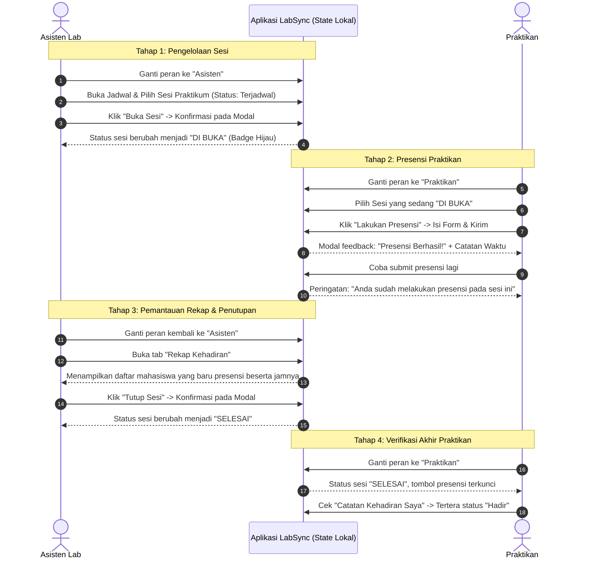

# Software Requirements Specification (SRS) & PRD
## Sprint 1: Antarmuka dan Alur Praktikum (LabSync)

---

## 1. Product Requirements Document (PRD)

### 1.1 Latar Belakang & Masalah
Kegiatan praktikum di laboratorium komputer/sains membutuhkan koordinasi yang rapi antara **Asisten Laboratorium** dan **Praktikan (Mahasiswa)**. Beberapa kendala operasional yang sering terjadi di lapangan meliputi:
- Praktikan kesulitan mengecek jadwal dan kepastian apakah sesi praktikum di lab sudah resmi dibuka oleh asisten.
- Presensi manual menggunakan kertas rentan manipulasi, lambat direkap, dan rawan double-entry.
- Asisten kesulitan memantau secara langsung siapa saja praktikan yang telah hadir selama sesi berlangsung.
- Praktikan sering ragu apakah kehadiran mereka sudah tercatat dengan valid.

**LabSync** dirancang sebagai aplikasi mobile (Expo / React Native) untuk mendigitalisasi alur operasional sesi praktikum, mulai dari pembukaan sesi, presensi mandiri praktikan, hingga rekapitulasi kehadiran seketika.

### 1.2 Tujuan & Batasan Sprint 1
Sprint 1 berfokus pada **Antarmuka dan Alur Interaksi Praktikum (Frontend & UX Prototype)**.

- **Fokus Utama**:
  1. Validasi alur pengguna (*user journey*) kedua belah pihak (Asisten dan Praktikan).
  2. Implementasi antarmuka responsif menggunakan **React Native Fundamental** (Flexbox, StyleSheet, useState, Modal, Form Input, Navigation).
  3. Pemilihan peran (*Role Switcher*) dan identitas pengguna melalui UI mockup.
- **Batasan (*Out of Scope*) Sprint 1**:
  - **Belum terhubung ke backend server atau database (No DB, No Cloud Sync)**.
  - Seluruh data menggunakan data lokal dummy/in-memory state yang aktif selama aplikasi berjalan.
  - Sesuai arahan teknis: *Data presensi tidak harus sinkron langsung via network antara device asisten dan praktikan (fully dummy flow, yang penting alur UI dan interaksi tervalidasi).*

### 1.3 Target Pengguna (User Persona)
1. **Asisten Laboratorium**:
   - Memeriksa jadwal praktikum yang diampu.
   - Membuka sesi praktikum saat waktu lab dimulai.
   - Memantau rekap kehadiran praktikan secara real-time pada sesi berjalan.
   - Menutup sesi praktikum saat kegiatan selesai.
2. **Praktikan (Mahasiswa)**:
   - Melihat jadwal praktikum, kelas, ruang lab, dan status sesi.
   - Melakukan presensi ketika sesi dibuka oleh asisten.
   - Menerima konfirmasi/feedback visual bahwa presensi berhasil.
   - Melihat catatan atau riwayat kehadiran pribadinya.

---

## 2. User Stories & Acceptance Criteria (AC)

Berdasarkan kompilasi kebutuhan pengguna Sprint 1, berikut adalah rincian kebutuhan fungsional:

### US-01: Jadwal & Detail Sesi Praktikum
> *Sebagai Pengguna (Asisten maupun Praktikan), saya ingin melihat daftar jadwal praktikum beserta informasi detailnya (nama praktikum, kelas, ruangan lab, waktu pelaksanaan, dan status sesi).*

**Acceptance Criteria:**
- [ ] Menampilkan daftar kartu (*session cards*) dengan informasi:
  - Nama Praktikum (contoh: *Pemrograman Mobile*, *Basis Data*).
  - Kode/Kelas (contoh: *IF-3A*, *SI-2B*).
  - Ruangan Lab (contoh: *Lab Komputer 3*, *Lab Jaringan*).
  - Jadwal Waktu (contoh: *08:00 - 10:00 WIB*).
  - Status Sesi: `Terjadwal` (*Scheduled*), `Dibuka` (*Open*), atau `Selesai` (*Closed*).
- [ ] Indikator visual status sesi menggunakan warna pembeda yang jelas (misal: Hijau = Dibuka, Abu-abu = Terjadwal, Merah/Gelap = Selesai).
- [ ] Menangani kondisi saat daftar jadwal kosong (*empty state*).

---

### US-02: Pengelolaan Sesi Praktikum (Khusus Asisten)
> *Sebagai Asisten, saya ingin dapat membuka dan menutup sesi praktikum dengan konfirmasi interaktif sehingga praktikan mengetahui status terkini sesi tersebut.*

**Acceptance Criteria:**
- [ ] Tersedia tombol aksi kontekstual pada halaman detail/dashboard asisten:
  - Tombol **"Buka Sesi"** ketika status sesi masih `Terjadwal`.
  - Tombol **"Tutup Sesi"** ketika status sesi sedang `Dibuka`.
  - Label non-aktif / badge statis saat sesi sudah `Selesai`.
- [ ] Terdapat dialog konfirmasi modal sebelum aksi buka atau tutup sesi dieksekusi (*mencegah salah klik*).
- [ ] Perubahan status sesi seketika terefleksi pada UI asisten.

---

### US-03: Pencatatan Presensi (Khusus Praktikan)
> *Sebagai Praktikan, saya ingin dapat melakukan presensi kehadiran ketika sesi praktikum telah dibuka, serta dicegah melakukan presensi ganda.*

**Acceptance Criteria:**
- [ ] Tombol **"Lakukan Presensi"** hanya aktif jika status sesi bernilai `Dibuka`.
- [ ] Jika status masih `Terjadwal` atau sudah `Selesai`, tombol presensi berstatus non-aktif (*disabled*) dengan keterangan yang jelas.
- [ ] Menampilkan formulir input presensi sederhana (NIM, Nama Praktikan, Catatan/Keterangan opsional).
- [ ] Validasi *Anti-Duplicate*: Praktikan dengan identitas yang sama tidak dapat melakukan presensi lebih dari 1 kali pada sesi yang sama.
- [ ] Menampilkan modal/dialog feedback sukses ketika presensi berhasil dicatat, lengkap dengan informasi timestamp waktu presensi.

---

### US-04: Rekapitulasi Sederhana Kehadiran
> *Sebagai Asisten, saya ingin melihat daftar rekap praktikan yang telah hadir; dan sebagai Praktikan, saya ingin melihat catatan kehadiran pribadi saya.*

**Acceptance Criteria:**
- [ ] **Sisi Asisten**:
  - Menampilkan daftar praktikan yang sudah presensi pada sesi terpilih.
  - Setiap baris/kartu menampilkan: Nama Praktikan, NIM, dan Waktu Presensi (Jam:Menit:Detik).
  - Menampilkan jumlah total praktikan yang hadir (misal: `Total Hadir: 18 Praktikan`).
  - Menampilkan *empty state* informatif jika belum ada praktikan yang presensi (*"Belum ada praktikan yang melakukan presensi pada sesi ini"*).
- [ ] **Sisi Praktikan**:
  - Menampilkan riwayat/status kehadiran praktikan yang sedang aktif (apakah sudah hadir pada sesi ini atau belum).

---

### US-05: Simulasi Peran & Identitas Pengguna (Role Switcher)
> *Sebagai Penguji Aplikasi/Evaluator Sprint 1, saya ingin dengan mudah berpindah peran antara Asisten dan Praktikan untuk mendemonstrasikan keseluruhan alur tanpa perlu sistem otentikasi login yang rumit.*

**Acceptance Criteria:**
- [ ] Terdapat tombol/toggle peran di bagian atas aplikasi (*Header / Top Bar*) untuk beralih antara:
  - Peran **Asisten** (Akses: Kelola sesi buka/tutup, lihat rekap seluruh mahasiswa).
  - Peran **Praktikan** (Akses: Presensi sesi aktif, lihat riwayat pribadi).
- [ ] Dropdown/pilihan identitas dummy praktikan (misal: Praktikan 1: Yudha, Praktikan 2: Agil, Praktikan 3: Zufar) untuk menguji validasi presensi ganda.

---

## 3. Alur Pengguna (User Flow) & Demonstrasi Sprint 1

Berikut adalah diagram alur yang menjadi target demonstrasi akhir Sprint 1:

---

## 4. Spesifikasi UI & UX Design

### 4.1 Panduan Tata Letak (Flexbox & Layout)
- Seluruh tampilan disusun menggunakan prinsip **Flexbox** bawaan React Native:
  - `flex: 1` untuk container utama.
  - `flexDirection: 'row'` untuk komponen kartu, badge, dan tombol berdampingan.
  - `justifyContent: 'space-between'` untuk header informasi jadwal.
  - `padding: 16` dan `gap: 12` untuk ritme visual yang konsisten.
- Menggunakan `SafeAreaView` dari `react-native-safe-area-context` agar tampilan aman pada notch perangkat iOS/Android.

### 4.2 Desain Komponen UI Kunci
1. **Header & Role Switcher**:
   - Terletak di posisi atas layar.
   - Berisi nama aplikasi (*LabSync*), badge peran saat ini, dan tombol toggle peran (*Switch Role*).
2. **Kartu Jadwal Praktikum (`SessionCard`)**:
   - Menampilkan judul mata praktikum dengan typography tebal (*Bold, 18px*).
   - Menampilkan baris meta: Ruang Lab, Jam Praktikum, Nama Kelas.
   - Badge status:
     - `TERJADWAL`: Latar kuning/abu-abu pastel, teks abu gelap.
     - `DIBUKA`: Latar hijau pastel (`#D1FAE5`), teks hijau tua (`#065F46`).
     - `SELESAI`: Latar merah pastel (`#FEE2E2`), teks merah tua (`#991B1B`).
3. **Formulir Presensi (`AttendanceForm`)**:
   - `TextInput` untuk NIM dan Nama Lengkap.
   - Input catatan opsional (misal: Nomor PC / Keterangan Lab).
   - Tombol utama "Kirim Presensi" dengan feedback visual ketika ditekan (*Pressable opacity/ripple*).
4. **Modal Konfirmasi & Feedback (`Modal` React Native)**:
   - Pop-up di tengah layar dengan backdrop semi-transparan (`rgba(0,0,0,0.5)`).
   - Modal Konfirmasi Buka/Tutup Sesi: Memuat teks pertanyaan, tombol "Batal", dan tombol aksi berwarna tegas.
   - Modal Sukses Presensi: Ikon ceklis, teks ucapan selamat, catatan jam kehadiran, dan tombol "Selesai".
5. **Daftar Rekapitulasi Kehadiran (`AttendanceList`)**:
   - Menampilkan kartu ringkas per mahasiswa yang hadir.
   - Informasi avatar inisial nama, NIM, dan waktu absensi.
   - *Empty State View*: Menampilkan ilustrasi/ikon sederhana dengan teks instruktif jika belum ada data.

### 4.3 Struktur Navigasi Layar (Expo Router)
Sesuai standar Expo Router pada direktori `src/app`:
- `src/app/index.tsx`: Halaman Beranda utama (Daftar Jadwal Praktikum & Akses Aksi Cepat).
- `src/app/session/[id].tsx`: Halaman Detail Sesi Praktikum (Aksi Sesi Asisten / Tombol Presensi Praktikan).
- `src/app/rekap/[id].tsx`: Halaman Rekapitulasi Presensi Sesi (Khusus Asisten & Arsip).
- `src/app/history.tsx`: Halaman Catatan Kehadiran Pribadi (Khusus Praktikan).

---

## 5. Kebutuhan Non-Fungsional (NFR)

1. **Responsivitas Tampilan**: Antarmuka harus rapi dan proporsional pada berbagai ukuran layar ponsel (Android & iOS).
2. **Keterbacaan & Aksesibilitas**: Kontras warna teks dan latar belakang memenuhi standar keterbacaan, ukuran tombol minimal 44x44 pt.
3. **Penyimpanan Status Dalam Memori**: Perubahan status sesi dan penambahan presensi langsung memperbarui UI tanpa perlu me-reload aplikasi.
4. **Validasi Tanpa Crash**: Input kosong atau presensi ganda harus ditangani dengan pesan error ramah pengguna tanpa menyebabkan error fatal aplikasi.
